# Workshop 2. Reliable Batch Data Pipeline

**Orchestrator:** Apache Airflow 3.1.8 (TaskFlow API)  
**Database:** MySQL 8.0  
**Data quality:** Great Expectations 1.23.1  
**Analytics:** MySQL KPI views and Power BI

This repository implements a batch ETL pipeline that integrates Spotify track listings with Grammy Awards records, validates data at raw and prepared gates, and loads a dimensional MySQL Data Warehouse. Airflow orchestrates the assessed workflow; Great Expectations evaluates quality rules; SQL views provide six KPIs for Power BI.

## Contents

1. [Problem, objective, and scope](#1-problem-objective-and-scope)
2. [Analytical requirements and KPIs](#2-analytical-requirements-and-kpis)
3. [Data sources](#3-data-sources)
4. [Pipeline architecture and responsibilities](#4-pipeline-architecture-and-responsibilities)
5. [Raw profiling findings and quality-risk catalogue](#5-raw-profiling-findings-and-quality-risk-catalogue)
6. [Quality rules and Great Expectations mapping](#6-quality-rules-and-great-expectations-mapping)
7. [Transformation and integration decisions](#7-transformation-and-integration-decisions)
8. [Dimensional model and data dictionary](#8-dimensional-model-and-data-dictionary)
9. [Airflow DAG design](#9-airflow-dag-design)
10. [Failure handling and retry policy](#10-failure-handling-and-retry-policy)
11. [Test A — successful run](#11-test-a--successful-run)
12. [Test B — controlled critical failure](#12-test-b--controlled-critical-failure)
13. [Repeatability and safe reruns](#13-repeatability-and-safe-reruns)
14. [KPI views, dashboard, and traceability](#14-kpi-views-dashboard-and-traceability)
15. [Setup and execution guide](#15-setup-and-execution-guide)
16. [Assumptions and limitations](#16-assumptions-and-limitations)
17. [Repository structure](#17-repository-structure)

---

## 1. Problem, objective, and scope

Spotify provides a snapshot of track popularity, audio features, and genre. The Grammy dataset records names, categories, and years associated with Grammy Awards. The only usable integration attribute shared by the sources is artist name.

The objective is to integrate the two sources into a trusted dimensional Data Warehouse and answer three analytical requirements while keeping source-quality issues visible and preventing invalid prepared data from being loaded.

**In scope**

- Read Spotify directly from the provided CSV.
- Load the provided Grammy CSV into a MySQL source table during source preparation, then extract Grammy from that relational table during ETL.
- Profile both datasets and translate observations into risks, rules, thresholds, and severity.
- Validate raw and prepared data with Great Expectations.
- Deduplicate Spotify exact copies, quarantine the row without an artist, normalize artist keys, enrich Spotify primary artists with Grammy-derived attributes, and calculate batch-specific popularity flags.
- Load the MySQL star schema transactionally and expose six DW-backed KPI views to Power BI.
- Demonstrate successful execution, a controlled critical failure, and safe reruns.

**Out of scope (things that are not included in this workshop)**

- Causal conclusions between Grammy recognition and Spotify popularity. The Spotify source has no date/year column.
- Identifying actual 2019 Grammy winners from the supplied file. The `winner` column is `True` in every row.
- Expanding every secondary Spotify collaborator into a separate fact row, the integration uses the primary artist.
- Use of external sources 

## 2. Analytical requirements and KPIs

| ID | Analytical requirement | Required data | Expected KPI(s) | Required level of detail |
|---|---|---|---|---|
| **R1** | In which genres is the presence of artists with a Grammy record concentrated? | Spotify: track_id, track_genre, artists. Grammy: year, artist, and nominee and category | **K1:** Percentage of tracks by artists with a Grammy record, by genre. | Track × genre, grouped by genre and Grammy status |
| **R2** | Do artists who have won a Grammy (1958–2018) have higher popularity than those who have not, and does it grow with the number of awards? | Spotify: track_id, artists, popularity. Grammy: year, artist, and nominee and category (only for Best New Artist) | **K2:** Mean and median popularity, artists with an award vs. artists with no Grammy record. **K3:** Percentage in the top 10% by group and ratio (with award ÷ no Grammy record) **K4:** K2 and K3 by award band (1, 2–4, 5–9, 10+) | Track × genre, with artist attributes: awards 1958–2018, 2019 records and status |
| **R3** | What share of the catalog of artists with a Grammy record has zero traction (popularity = 0)? | Spotify: track_id, track_genre, artists (primary), popularity. Grammy: year, artist, and nominee and category. | **K5:** Percentage of tracks with popularity 0, artists with a Grammy record vs. rest of the catalog **K6:** K5 by genre | Track × genre, grouped by genre and Grammy status |

### KPI definitions used by the SQL views

| KPI | Definition | Interpretation / caution |
|---|---|---|
| **K1 Grammy-record share by genre** | `AVG(has_grammy_record) * 100`, grouped by `track_genre` in `VW_KPI_BASE` | Share of fact listings in each genre linked to Grammy-record artists. |
| **K2 Popularity comparison** | Mean and median `popularity` for `with_award` and `no_record` | Descriptive group comparison. |
| **K3 Top-10% share and ratio** | Percentage of each group with `is_top10_global = 1`; ratio = `with_award` percentage / `no_record` percentage | p90 is calculated for the current batch. It was 63 in the profiled snapshot. |
| **K4 Award bands** | Mean, median, and Top-10% share by `wins_band` | Review `sample_status`, small bands (29 < data). |
| **K5 Zero traction by segment** | `AVG(is_zero_traction) * 100` for `artists_with_grammy` and `rest_of_catalog` | `is_zero_traction = (popularity == 0)`. |
| **K6 Zero traction by genre** | Zero-traction listings among Grammy-associated rows divided by all Grammy-associated listings in the genre | `no data` means that genre doesn't have tracks that have won the grammy. `small sample` means 1–29 Grammy-associated listings; `ok` means at least 30. |

## 3. Data sources

| Source | Provided form | Observed shape | How the pipeline reads it | Path / table |
|---|---|---:|---|---|
| Spotify tracks | CSV, UTF-8 | 114,000 rows × 21 columns (20 data columns + exported index) | `extract_spotify` reads the file directly | `data/raw/spotify_dataset.csv`; container path `/opt/airflow/data/raw/spotify_dataset.csv` |
| Grammy Awards | CSV used for source preparation | 4,810 rows × 10 columns | `prepare-source` loads the CSV into MySQL; operational `extract_grammys` queries the MySQL source table | CSV: `data/raw/the_grammy_awards.csv`; table: `grammy_source.grammy_awards` |

The source-preparation logic converts timestamp text to UTC-compatible MySQL DATETIME values, converts `winner` to a MySQL-compatible boolean value and converts empty fields to SQL `NULL`.

## 4. Pipeline architecture and responsibilities

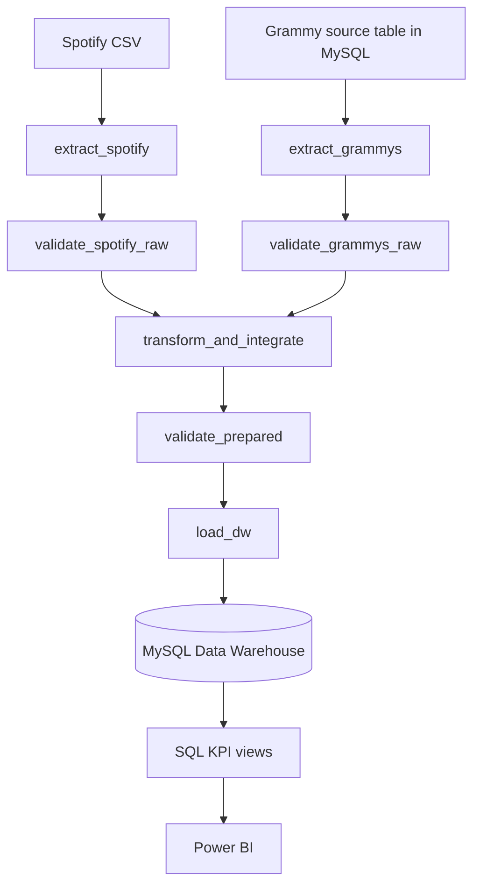

### Component responsibilities

| Component | Responsibility |
|---|---|
| `docker-compose.yaml` | Runs MySQL and Airflow services, mounts project data, and supplies environment variables. |
| `mysql` | Hosts Airflow metadata (`airflow_db`), the Grammy source (`grammy_source`), and the Data Warehouse (`dw`). |
| `dags/reliable_music_pipeline.py` | Defines the active seven-task Airflow DAG using `from airflow.sdk import dag, task`. |
| `src/extract.py` | Extracts Spotify and Grammy to batch-scoped Parquet; contains source-preparation logic for Grammy. |
| `src/validation.py` | Runs Great Expectations raw and prepared gates, writes result JSON, and blocks critical failures. |
| `src/transform.py` | Deduplicates, quarantines, normalizes, integrates, derives artist statuses and popularity flags, and writes prepared Parquet files. |
| `src/load.py` | Creates/resets DW schema and performs a transactional, chunked upsert of dimensions, fact, quarantine, and batch control. |
| `src/kpis.py` | Creates six SQL KPI views, recalculates KPIs from DW tables with pandas, compares calculations against SQL views, and writes cross-check evidence. |
| `main.py` | Administrative/verification CLI plus a direct end-to-end ETL. |
| `gx/` | Persistent Great Expectations context, expectation suites, validation definitions, and checkpoints. |
| `sql/source_setup.sql`, `sql/dw_schema.sql`, `sql/kpi_queries.sql` | Source DDL, dimensional/control DDL, and DW KPI views. |

## 5. Raw profiling findings and quality-risk catalogue

There are two notebooks each one with different purposes:

- `notebooks/initial_profiling.ipynb`: basic exploratory profiling of both raw CSVs locally.
- `notebooks/data_profiling.ipynb`: the detailed Workshop-2 profile, reading spotify from its CSV, while Grammy is read from the source database, its purpose is to profile interesting and useful findings in the initial profiling, how the tables would end after transform and which findings can be found there.

The documented shared artist normalizer is `normalize_artist_name()` in `src/transform.py`: Unicode NFKD normalization, removal of combining marks, lowercasing, punctuation removal while preserving word/space characters, whitespace collapse, and trimming. Empty normalized values are not valid integration keys.

### Main profiling findings

| Dataset / attribute | Profiling evidence | Potential quality risk | Related requirement |
| :--- | :--- | :--- | :--- |
| Spotify / complete table | Structure: 114,000 rows × 21 columns (20 data columns + unnamed index); profile types {'decimal': 9, 'integer': 6, 'text': 5, 'boolean': 1}. Completeness: 3 null cells across artists, album_name, track_name; all on 1 row. | If a row lacks the artist, album, and title together, it cannot be reliably identified or assigned to an artist, retaining it without an explicit policy can distort counts or create unusable fact records. | R1–R3 |
| Spotify / Unnamed: 0 | Structure: blank first header cell=True; values 0…113999 (114,000 unique); equals row number=True. | Using the sequential export index as a business key, or including it in exact-equality checks, can make duplicate rows appear unique and inflate retained row counts. | — |
| Spotify / track_id | Structure: 22-character alphanumeric pattern 100.00%; completeness: 0 nulls. Uniqueness: 89,741 distinct IDs in 114,000 rows; 24,259 excess rows = 450 exact copies + 23,809 cross-genre repeats (16,299 tracks span 2–9 genres). Numeric consistency: 720 tracks have differing popularity across rows. | Retaining exact copies can inflate track–genre counts and KPI denominators. Repeated track_id values across different genres are valid under the declared grain; differing popularity across listings means popularity must not be assumed identical for every occurrence of a track. | R1–R3 |
| Spotify / track_genre | Categorical: 114 lowercase genres, 0 edge-space rows, rows per genre 1000. Completeness: 0 nulls. after copy removal each genre has 904–1000 rows. | Because every genre has exactly 1,000 raw rows, raw counts reflect the supplied dataset construction or sampling, not real-world genre prevalence, so without the proper caution this can be interpreted in a bad way. | R1, R3 |
| Spotify / artists | Completeness: 1 null. Multivalued structure: 26.4% of rows have 2+ credited artists (max 38); 31,437 artist-list strings -> 29,858 individual names. Categorical: 1,974 individual names contain non-ASCII characters; 47 case-only collisions; 8 edge-space occurrences. | Treating the full multi-artist string as one identity, or failing to normalize Unicode, case, and whitespace consistently, can create missed or incorrect Grammy matches and misclassify listings by artist status. | R1–R3 |
| Spotify / album_name, track_name | Completeness: 1 album null and 1 title null on the same row. Categorical: 46,589 distinct albums, 73,608 distinct titles; 7,991 titles are shared by 2+ track IDs (maximum 48: "Rockin' Around The Christmas Tree"). | Using title or album text as a unique key can merge different tracks or create false source links; repeated titles across track IDs show that the title alone is not unique. | — |
| Spotify / popularity | Numeric: integer 0–100; 0 out of range; mean 33.2, median 35, p25/p75/p90/p99=17/50/63/80; rows at 100: 2. Score 0 share 14.05% vs score 1 1.88%. | Treating zero as missing would undercount zero-popularity listings; interpreting this undated relative score as a historical or causal measure could also mislead comparisons with Grammy recognition. The Top-10% cutoff is snapshot/batch-dependent. | R2, R3 |
| Grammy / complete table | Structure: 4,810 rows × 10 columns. Per source preparation, published_at and updated_at are stored as UTC DATETIME with the original offset suffix removed, winner is stored as 1/0. Completeness: nulls {'nominee': 6, 'artist': 1840, 'workers': 2190, 'img': 1367}. Uniqueness profile: full-row duplicate count 0. (year, category, nominee) duplicate count 0. | A null nominee leaves the candidate key (year, category, nominee) incomplete for six records. Any matching, deduplication, or reconciliation that relies on that key may be unable to identify those rows reliably. | R1–R3 |
| Grammy / year | Temporal: 1958–2019; 62 years, rows/year min 28, median 75, max 433 (433 records in 2019, 9.0%). | Combining 2019 records with 1958–2018 as if they had the same meaning risks classifying nominees as confirmed winners and distorting historical award comparisons. | R2 |
| Grammy / published_at, updated_at | Temporal: stored UTC DATETIME values parseable 4810/4810, original CSV timezone suffixes are not present in the source table. Max distinct timestamp per award year 1 published / 1 updated; total distinct values 4 / 10; published_at range 2017-11-28–2020-05-19; updated_at range 2017-11-28–2020-09-01; updated < published in 0 rows; published year agrees with award year in 1.8%. | Treating website publication/update timestamps as award-event dates can assign records to the wrong time period and create invalid temporal comparisons with Spotify popularity. | — |
| Grammy / category | Categorical: 638 raw labels -> 629 normalized; whitespace anomalies 2; top categories [('Song Of The Year', 70), ('Record Of The Year', 69), ('Album Of The Year', 66)]; single-row categories 224, with <=5 rows 385. Completeness: no nulls. | Category label variants can split the same logical category across groups, while category definitions may change over time. This can distort category-level summaries and mishandle Best New Artist variants if normalization is inconsistent. | R1–R3 |
| Grammy / nominee | Completeness: 6 nulls (Best New Country & Western Artist (1965); Best New Country & Western Artist Of 1964 (1964); Remixer Of The Year, Non-Classical (1997–1999); Remixer Of The Year, Non-classical (1998); Remixer of the Year, Non-Classical (2000)). Categorical: 4,131 distinct non-null values; whitespace anomalies 7. Meaning can be a work title or a person depending on category. | Using nominee as an artist identifier for every category risks matching song/work titles to Spotify artists. It should only be treated as an artist under the documented Best New Artist rule. | R1–R3 |
| Grammy / nominee + category (Best New Artist) | Cross-source: 66 rows in 8 category spellings; artist is null in 65 rows; nominee matches a Spotify primary key in 32. Outside this family, 1,769 rows have artist null and nominee present; 28 such nominees happen to match a Spotify artist. | Using nominee as a fallback artist outside Best New Artist can produce false artist matches when nominee actually names a song or work rather than a person. | R1–R3 |
| Grammy / artist | Completeness: 1,840 nulls (38.3%); 1,758 in 246 categories that always omit artist. Song Of The Year: 70/70 null. Categorical: 1,658 distinct, Featuring=86, '&'=411, With=20; non-ASCII rows=99. | The high number of null artist values means many Grammy rows cannot be linked directly to Spotify. Treating null as “no Grammy record” can undercount recognition; filling it indiscriminately from other text can create false matches. | R1–R3 |
| Grammy / winner | Categorical: rows = 4810. Source preparation converts CSV True/False to MySQL boolean-compatible 1/0; in this observed table all stored values represent True (True = 1). | Because all 4,810 stored values are true, this field cannot distinguish winners from nominees in this source. Using it to classify winners would mislabel records and bias the award-based KPIs. | R2 |
| Grammy / year × category | Uniqueness: 1958–2018 has 4,346 combinations with sizes {1: 4315, 2: 31}; 2019 has 433 rows across 84 categories, group sizes {5: 79, 6: 1, 8: 4}; Record Of The Year 2019 has 8 nominees, stored winner values={'1'} (1 represents True). | Assuming the same row grain and award-outcome meaning for every year risks treating the 2019 nominee list as final results. The interpretation of 1958–2018 as historical results is also an inference from the observed grain, not proof from winner. | R2 |
| Both / artist integration key | Cross-source: no shared ID; names only. Spotify 29,858 names -> 29,757 keys; Grammy 1,658 artist strings -> 1,646 keys. 539 Grammy keys appear in Spotify; 1429 rows have a non-generic any-credit match; 483 of 17622 Spotify primary artists have a Grammy match. | Name-only matching without a shared artist ID can create false negatives from spelling/credit variants and false positives from homonyms or combined names, changing artist classifications and all KPIs that depend on them. | R1–R3 |
| Both / artist matching (resolvable rows) | Cross-source: 1,199 of 2,969 resolvable Grammy rows (excluding Various Artists) match a Spotify primary artist: 40.4%. Step rates: {'A. Raw artist text': 1078, 'B. + Unicode normalization': 1117, 'C. + split Featuring credits': 1167, 'D. + Best New Artist nominee rule': 1199}. | Match coverage depends on the resolvable-row denominator, normalization, and credit-splitting rules. Changes can materially shift DQ15 and artist classifications; a text match alone does not prove identity. | R1–R3 |
| Both / "Various Artists" | Cross-source: 1,199 of 2,969 resolvable Grammy rows match a Spotify primary artist (40.4%), excluding Various Artists. | Using the generic Various Artists label as an artist key can falsely match unrelated compilations and assign Grammy status to artists who were not actually identified. | R1–R3 |
| Both / time | Temporal: Spotify has no date/year field; Grammy `year` spans 1958–2019; `popularity` is an undated snapshot. | Spotify has no track observation date, so the data cannot establish popularity before or after a Grammy event. Presenting the comparison as historical change or a causal effect would be misleading. | R2 |
| Both / genre versus category | Cross-source: Spotify has 114 genres; Grammy has 638 raw categories (629 after normalization); no shared ID or directly equivalent vocabulary. | Spotify genres and Grammy award categories have no supported one-to-one mapping. Assuming equivalence would create unsupported cross-source conclusions and misleading genre/category analyses. | R1 |

### Quality-risk catalogue RK01–RK15

| Risk | Profiling finding | Potential impact | Pipeline handling |
|---|---|---|---|
| **RK01** | 450 Spotify exact extra copies, 444 groups, 894 implicated rows | Inflated fact counts and double-counted measures | DQ04 warning; TD01 removes exact copies. |
| **RK02** | One row missing `artists`, `album_name`, and `track_name` | Cannot link a fact row to an artist | DQ05 gate policy; TD02 quarantines as `missing_artist`. |
| **RK03** | 89,741 distinct track IDs; tracks span multiple genres | `track_id` alone is not a unique listing key | Fact grain is `(track_key, genre_key)`; DQ10 validates prepared grain. |
| **RK04** | 26.4% rows have multiple artist credits | Expanding all artists could cause fact row explosion | TD03 uses primary artist. |
| **RK05** | 14.05% popularity zeros | Zero cohort affects distribution and traction analysis | TD06 derives `is_zero_traction`. |
| **RK06** | Observed p90 popularity is 63 | Static threshold becomes stale if data distribution changes | Recompute p90 for every batch, verify flag consistency with DQ13. |
| **RK07** | Grammy `winner` is always True | The field cannot distinguish winners | Ignore `winner` for win counting, apply the year-based assumption. |
| **RK08** | 2019 contains 433 rows in 84 categories, 5–8 per category | Treating each as a confirmed win overstates awards | Store `grammy_records_2019` separately and exclude from historical-win count. |
| **RK09** | `artist` null in 1,840 Grammy records, Best New Artist has a special fallback | Many records cannot be matched from `artist` alone | TD05 uses `nominee` only for Best New Artist with empty `artist`. |
| **RK10** | 66 Grammy rows have Various Artists | False positive generic-name match | Exclude the generic marker. |
| **RK11** | 31 historical `(year, category)` groups have two rows | Award-count interpretation may overcount some co-credits | Treat each source row as a draw for both tracks. |
| **RK12** | Matching is text-based with no shared artist ID | Homonyms can merge, aliases may fail to link | Record limitation and matching metrics. |
| **RK13** | Only a subset of resolvable Grammy records maps to Spotify primary artists | Changing match coverage may affect R1–R3 | DQ15 enforces per-batch match-rate threshold. |
| **RK14** | 720 track IDs have differing popularity across genre listings | Deduplicating by track ID would discard source variation | Preserve track × genre grain. |
| **RK15** | Normalized artist business key must be unique | Duplicate keys break dimension and foreign-key integrity | DQ12 plus unique constraint on `DIM_ARTIST.artist_key_norm`. |

## 6. Quality rules and Great Expectations mapping

### DQ rules

| Rule ID | Dataset / Layer | Attribute(s) | Quality Dimension | Quality Rule | Metric/ Threshold | Severity | Related Requirement(s) |
|---|---|---|---|---|---|---|---|
| DQ01 | Spotify raw, Grammy raw | Spotify: `track_id`, `track_name`, `album_name`, `artists`, `popularity`, `track_genre`. Grammy: `year`, `category`, `nominee`, `artist` | Validity | All required columns must be present in each raw source. | 100% | Critical | R1-R3 |
| DQ02 | Spotify raw | `track_id`, `track_genre` | Completeness | Values must be non-null | 100% | Critical | R1-R3 |
| DQ03 | Spotify raw | `popularity` | Validity | Values must be non-null, integers and be between 0 and 100 inclusive. | 100% | Critical | R2, R3 |
| DQ04 | Spotify raw | `track_id`, `track_genre` | Uniqueness | Each track and genre pair must appear in only one row. | 0 repeated rows | Warning | R1-R3 |
| DQ05 | Spotify raw | `artists` | Completeness | Values must be non-null; rows without an artist go to quarantine. | >= 99% | Critical | R1-R3 |
| DQ06 | Grammy raw | `year`, `category` | Completeness / Validity | Values must be non-null, and year must be between 1958 and 2019 inclusive. | 100% | Critical | R1-R3 |
| DQ07 | Grammy raw | Whole Grammy table | Completeness | The number of extracted rows must equal the number of rows recorded at import. | Difference = 0 | Critical | R1-R3 |
| DQ08 | Grammy raw | `year`, `category` | Consistency | For records from 1958 to 2018, each year and category pair must have at most 2 rows. | 100% of combinations | Critical | R2 |
| DQ09 | Prepared | All columns | Validity (structure) | Columns and data types must match the model. | 100% | Critical | R1-R3 |
| DQ10 | Prepared | `track_id`, `track_genre` | Uniqueness | The fact table key must be unique. | 0 duplicates | Critical | R1-R3 |
| DQ11 | Prepared | Row counts | Completeness / Consistency | Prepared rows must equal raw rows minus exact copies minus quarantined rows. | Difference = 0 | Critical | R1-R3 |
| DQ12 | Prepared | `artist_key_norm` | Consistency | The primary artist must be present and exist in DIM_ARTIST. | 100% | Critical | R1-R3 |
| DQ13 | Prepared | `popularity`, `is_zero_traction`, `is_top10_global` | Validity | Flags must be consistent with popularity and use a single threshold. | 100% | Critical | R2, R3 |
| DQ14 | Prepared | `grammy_status`, `grammy_wins_1958_2018`, `grammy_records_2019`, `has_grammy_record`, `wins_band` | Validity | Domains and coherence of the Grammy attributes must hold. | 100% | Critical | R1-R3 |
| DQ15 | Prepared | Grammy to Spotify matching | Consistency | Resolvable Grammy rows must be matched to a primary Spotify artist. | >= 10% | Critical | R1-R3 |


### Great Expectations suite and gate mapping


| GX ID | DQ rule | Suite / gate | Expectation or check | Target | Severity / notes |
|---|---|---|---|---|---|
| GX01 | DQ01 | `spotify_raw` | `ExpectTableColumnsToMatchSet` | Required Spotify columns. | Critical. |
| GX02 | DQ02 | `spotify_raw` | `ExpectColumnValuesToNotBeNull` | `track_id` | Critical. |
| GX03 | DQ02 | `spotify_raw` | `ExpectColumnValuesToNotBeNull` | `track_genre` | Critical. |
| GX04 | DQ03 | `spotify_raw` | `ExpectColumnValuesToBeBetween` | `popularity` | Critical. |
| GX05 | DQ04 | `spotify_raw` | `ExpectCompoundColumnsToBeUnique` | `track_id`, `track_genre` | Warning, expected raw warning: 894 implicated rows, 450 copies in baseline. |
| GX06 | DQ05 | `spotify_raw` | `ExpectColumnValuesToNotBeNull` | `artists`, `mostly=0.99` | Critical gate with documented tolerance (quarantine). |
| GX07 | DQ01 | `grammy_raw` | `ExpectTableColumnsToMatchSet` | `year`, `category`, `nominee`, `artist` | Critical. |
| GX08 | DQ06 | `grammy_raw` | `ExpectColumnValuesToNotBeNull` | `year` | Critical. |
| GX09 | DQ06 | `grammy_raw` | `ExpectColumnValuesToBeBetween` | `year` | Critical. |
| GX10 | DQ06 | `grammy_raw` | `ExpectColumnValuesToNotBeNull` | `category` | Critical. |
| GX11 | DQ07 | `grammy_raw` | `ExpectTableRowCountToEqual` | Whole table vs. source import control. | Critical. |
| GX12 | DQ08 | `grammy_raw` | `ExpectColumnValuesToBeBetween` | `dq08_row_count`, historical size 1–2, 2019 special | Critical. |
| GX13 | DQ09 | `prepared_fact` | `ExpectTableColumnsToMatchSet` | Prepared fact schema | Critical. |
| GX14 | DQ10 | `prepared_fact` | `ExpectCompoundColumnsToBeUnique` | `track_id`, `track_genre` | Critical. |
| GX15 | DQ11 | `prepared_fact` | `ExpectTableRowCountToEqual` | Prepared fact count from reconciliation metadata | Critical. |
| GX16 | DQ12 | `prepared_fact` | `ExpectColumnValuesToNotBeNull` | `artist_key_norm` | Critical. |
| GX17 | DQ13 | `prepared_fact` | `ExpectColumnValuesToBeInSet` | `dq13_zero_coherent` = 1 | Critical, zero-traction flag coherence. |
| GX18 | DQ13 | `prepared_fact` | `ExpectColumnValuesToBeInSet` | `dq13_top10_coherent` | Critical, top-10 flag coherence. |
| GX19 | DQ12 | `prepared_dim_artist` | `ExpectColumnValuesToBeUnique` | `artist_key_norm` | Critical. |
| GX20 | DQ14 | `prepared_dim_artist` | `ExpectColumnValuesToBeInSet` | `grammy_status` | Critical. |
| GX21 | DQ14 | `prepared_dim_artist` | `ExpectColumnValuesToBeInSet` | `wins_band` | Critical. |
| GX22 | DQ14 | `prepared_dim_artist` | `ExpectColumnValuesToBeInSet` | `has_grammy_record` | Critical. |
| GX23 | DQ14 | `prepared_dim_artist` | `ExpectColumnValuesToBeInSet` | `dq14_status_coherent` | Critical. |
| GX24 | DQ15 | Custom prepared check | Python match-rate assertion | `grammy_match_rate_pct` | Critical. |

## 7. Transformation and integration decisions

| Decision | Rule / fields | Observed before → after | Rationale and exception handling | Analytical impact |
|---|---|---|---|---|
| **TD01 Exact-copy removal** | Compare all 20 Spotify data columns, excluding the exported `Unnamed: 0` index / `source_row_id`, retain first copy. | 114,000 → 113,550 rows, 450 extra copies removed. | Duplicates are recorded in metadata, raw source stays unchanged. | Prevents fact row and aggregate inflation. |
| **TD02 Missing primary artist** | Quarantine null/empty `artists`, reason `missing_artist`. | 113,550 after deduplication → 113,549 fact candidates; one row quarantined. | That row also lacks `track_name` and `album_name`, `artists` is the criterion because it cannot be linked to the artist dimension. Quarantine Parquet is written under the batch work directory and loaded to `quarantine_spotify`. | Keeps FK chain valid while retaining an audit record. |
| **TD03 Primary Spotify artist** | Split `artists` on `;`, trim, and use the first token as `primary_artist_name`; preserve full string and count. | Original multi-credit string → `primary_artist_name`, `artists_raw`, `n_artists`. | Null/empty names are removed by TD02. Secondary collaborators are not expanded to separate fact rows. | Consistent artist integration without row explosion. |
| **TD04 Grammy year counts** | Count rows with `year <= 2018` as historical award records, count 2019 rows separately in `grammy_records_2019`, `winner` is not used. | Raw Grammy rows → per-normalized-artist wins and 2019 record count. | `winner` is constant `True`. The historical winner interpretation for 1958–2018 and the 2019 nominee-list interpretation are assumptions based on source structure. Unresolvable artist keys are reported separately. | `grammy_status`, `has_grammy_record`, `wins_band`, and K2–K4 groups. |
| **TD05 Grammy artist key resolution** | If category is Best New Artist and artist is empty, use `nominee`, if artist contains ` Featuring `, use text before it, exclude `(Various Artists)`. | Mixed text/null fields → resolved artist or no key. | `&` or `With` aren't splited on because these can occur in legitimate group names. Unresolvable rows remain outside the artist aggregate are included/excluded from match-rate denominator according to resolvability rules. | Reduces avoidable false matches while keeping limitations visible. |
| **TD06 Analytical flags** | `is_zero_traction = (popularity == 0)`; `is_top10_global = (popularity >= p90)`. | Raw popularity → two flags and stored batch p90 threshold. | p90 is recomputed each batch and recorded in `etl_control_batch`, baseline p90 is 63. | K3, K5, and K6, DQ13 validates consistency. |

### Artist integration contract

- **Key:** `artist_key_norm`, using the shared function `normalize_artist_name()` in `src/transform.py`.
- **Normalization steps:** Unicode NFKD; remove combining diacritics; lowercase; remove punctuation while retaining word/space characters; collapse whitespace; trim; empty normalized values do not form a key.
- **Join strategy:** aggregate resolvable Grammy rows by normalized artist first, then left-join the aggregation to Spotify primary artists. This prevents many-to-many row explosion and preserves Spotify artists without a Grammy match.
- **Display name:** use the most frequent observed Spotify primary-artist spelling for a normalized key.
- **Status:** derive `grammy_status`, `grammy_wins_1958_2018`, `grammy_records_2019`, `has_grammy_record`, and `wins_band` from the resolved artist counts.
- **Reconciliation:** every candidate fact row is accounted for by raw rows minus exact copies minus quarantined rows.

## 8. Dimensional model and data dictionary

**Fact grain:** One row in `fact_track_genre` represents one Spotify track listed under one genre in the catalog snapshot, together with the popularity score recorded for that listing and the Grammy recognition attributes of the track’s primary artist.

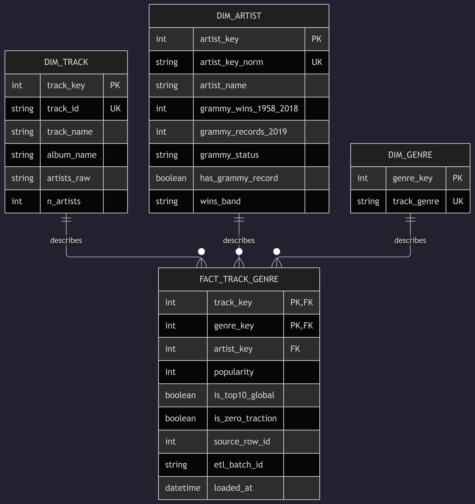

Editable dimensional diagram: [`docs/star_schema.mmd`](docs/star_schema.mmd). DDL: `sql/dw_schema.sql`.

### DIM_TRACK

| Column | Type | Constraint | Meaning |
|---|---|---|---|
| `track_key` | `INT AUTO_INCREMENT` | Primary key | Surrogate key. |
| `track_id` | `CHAR(22)` | Unique, not null | Spotify track business key. |
| `track_name` | `VARCHAR(600)` | Nullable | Track display name. |
| `album_name` | `VARCHAR(300)` | Nullable | Album display name. |
| `artists_raw` | `VARCHAR(1000)` | Nullable | Original semicolon-separated artist credit list. |
| `n_artists` | `TINYINT` | Not null | Number of credited artists. |

### DIM_ARTIST

| Column | Type | Constraint | Meaning |
|---|---|---|---|
| `artist_key` | `INT AUTO_INCREMENT` | Primary key | Surrogate key. |
| `artist_key_norm` | `VARCHAR(150)` | Unique, not null | Normalized artist business key. |
| `artist_name` | `VARCHAR(150)` | Not null | Display name of the artist. |
| `grammy_wins_1958_2018` | `SMALLINT` | Not null | Count of Grammy source rows from 1958–2018. |
| `grammy_records_2019` | `SMALLINT` | Not null | Count of 2019 records. |
| `grammy_status` | `VARCHAR(30)` | Not null | `historical winner`, `winner + 2019`, `2019 only`, or `no record`. |
| `has_grammy_record` | `TINYINT` | Not null | Binary flag indicating an associated Grammy record. |
| `wins_band` | `VARCHAR(20)` | Not null | `none`, `1`, `2-4`, `5-9`, or `10+`. |

### DIM_GENRE

| Column | Type | Constraint | Meaning |
|---|---|---|---|
| `genre_key` | `INT AUTO_INCREMENT` | Primary key | Surrogate key. |
| `track_genre` | `VARCHAR(50)` | Unique, not null | Genre business key. |

### FACT_TRACK_GENRE

| Column | Type | Constraint | Meaning |
|---|---|---|---|
| `track_key` | `INT` | Not null, FK to `DIM_TRACK` | Track reference. |
| `genre_key` | `INT` | Not null, FK to `DIM_GENRE` | Genre reference. |
| `artist_key` | `INT` | Not null, FK to `DIM_ARTIST` | Primary artist reference. |
| `popularity` | `TINYINT` | Not null | Spotify popularity, 0–100. |
| `is_top10_global` | `TINYINT` | Not null, default 0 | 1 when popularity is at or above current batch p90. |
| `is_zero_traction` | `TINYINT` | Not null, default 0 | 1 when popularity equals 0. |
| `source_row_id` | `INT` | Not null | Original CSV row index for lineage. |
| `etl_batch_id` | `VARCHAR(40)` | Not null | Batch identifier. |
| `loaded_at` | `DATETIME` | Not null | UTC load timestamp. |

**Primary key:** `(track_key, genre_key)`.

### Control and quarantine tables

- **`etl_control_batch`:** one row per batch ID; records start/completion time, raw Spotify count, copies removed, quarantined rows, candidate/loaded fact counts, dimension counts, Grammy imported/extracted/resolvable/matched counts, match-rate percentage, p90 threshold, and batch status.
- **`quarantine_spotify`:** records excluded rows with `quarantine_id`, `etl_batch_id`, `source_row_id`, `track_id`, `reason`, `raw_data`, and `quarantined_at`. A unique key on `(source_row_id, reason)` makes the same quarantine decision repeatable.

### Observed baseline counts

| Table / stage | Observed rows |
|---|---:|
| Raw Spotify CSV | 114,000 |
| Exact Spotify copies removed | 450 |
| Spotify row quarantined for missing artist | 1 |
| **FACT_TRACK_GENRE** | **113,549** |
| `DIM_TRACK` | 89,740 |
| `DIM_ARTIST` | 17,622 |
| `DIM_GENRE` | 114 |
| `quarantine_spotify` | 1 |
| `grammy_source.grammy_awards` | 4,810 |

These are observed baseline counts in the included evidence. DQ11 checks row conservation using the current batch metadata.

## 9. Airflow DAG design

**DAG:** `reliable_music_pipeline`  
**File:** `dags/reliable_music_pipeline.py`  
**API:** TaskFlow (`from airflow.sdk import dag, task`)  
**Schedule:** manual trigger (`schedule=None`, `catchup=False`)

| Task ID | Function / purpose | Depends on | Retries | Retry delay |
|---|---|---|---:|---:|
| `extract_spotify` | Reads Spotify CSV and writes raw Parquet | None | 0 | — |
| `validate_spotify_raw` | Validates raw Spotify data, DQ01–DQ05 | `extract_spotify` | 0 | — |
| `extract_grammys` | Reads `grammy_source.grammy_awards` and writes raw Parquet | None | 2 | 10 seconds |
| `validate_grammys_raw` | Validates raw Grammy data, DQ01/DQ06–DQ08 | `extract_grammys` | 0 | — |
| `transform_and_integrate` | Deduplicates, quarantines, resolves artists, computes flags, and writes prepared outputs | Both raw validation tasks | 0 | — |
| `validate_prepared` | Validates fact/dimension outputs and custom DQ15 | `transform_and_integrate` | 0 | — |
| `load_dw` | Transactional DW upsert | Successful `validate_prepared` result required | 2 | 10 seconds |


- `extract_grammys` and `load_dw` are configured with two retries and a 10-second delay. Their exception handling distinguishes retryable SQLAlchemy `OperationalError` exceptions from other errors that bypass retries.
- Configuration shows the intended retry behavior, but does not by itself prove that a transient outage recovered successfully. That requires execution logs or a recorded retry test.
- The two source branches run independently and converge only after both raw validation gates pass. 
- If a task can't be completed due to a critical failure then the other task that go next after the failure task won't be done.
- A rerun doesn't duplicate rows, it overwrites them.

## 10. Failure Handling and Retry Policy

Critical data-quality failures block unsafe downstream processing. Warnings are recorded and processing continues only where the documented policy permits it.

| Condition | Severity / Type | Pipeline Response | Retry? | Justification |
|---|---|---|---|---|
| Spotify CSV is missing or unreadable | Operational failure | `extract_spotify` fails. The Spotify validation and downstream tasks do not proceed, so the failed run cannot reach the DW load. | No, 0 retries | The file path or file access must be corrected, repeating the same operation does not resolve a missing or unreadable file. |
| Temporary MySQL connection failure during `extract_grammys` | Transient operational failure | The task re-raises SQLAlchemy `OperationalError`, allowing Airflow to retry the extraction. Downstream processing waits for successful extraction and validation. | Yes, up to 2 retries, 10 seconds apart | A temporary database connection failure may resolve without changing the data or code. |
| Non-transient error during Grammy extraction | Deterministic operational/configuration failure | The task raises `AirflowFailException`, and the Grammy branch cannot proceed to raw validation or transformation. | No, automatic retries are bypassed | Missing tables, invalid configuration, or other non-transient errors require correction rather than repetition. |
| Critical Spotify raw validation failure (DQ01–DQ03 or DQ05 threshold violation) | Critical data-quality failure | `validate_spotify_raw` fails and prevents transformation, prepared validation, and loading. | No, 0 retries | The validation task is configured with `retries=0` due to this DQ being of principal validation (If they trigger is because a file is missing or corrupted). The invalid input or source contract must be corrected. |
| Critical Grammy raw validation failure (DQ01, DQ06–DQ08) | Critical data-quality/consistency failure | `validate_grammys_raw` fails and blocks the convergence step and downstream processing. | No, 0 retries | Schema, domain, import-count, and historical year–category violations are deterministic and require investigation. DQ07 also requires a valid import-control record. |
| Repeated Spotify `(track_id, track_genre)` pairs detected (DQ04) | Warning | The raw validation result records the warning and allows processing to continue under the severity policy. TD01 removes exact copies, prepared validation checks fact-key uniqueness through DQ10. | No retry required | DQ04 is explicitly configured as a Warning. Reprocessing the same raw source is unnecessary because the known exact-copy issue is handled during transformation. |
| Spotify row has no primary artist but DQ05 remains within its 99% completeness threshold | Data-quality exception handled by quarantine | Raw validation can pass. `transform_and_integrate` quarantines the affected row with reason `missing_artist`, while other eligible rows continue. | No, transformation has 0 retries | The row cannot be reliably assigned to an artist. Quarantine preserves the exception without discarding the entire batch. |
| Deterministic transformation or integration error | Deterministic processing failure | `transform_and_integrate` fails. Prepared validation and loading do not proceed normally. | No, 0 retries | The transformation task is configured with `retries=0`. The underlying input, logic, or configuration must be corrected. |
| Critical prepared validation failure (DQ09–DQ15), including DQ15 match rate below 10% | Critical data-quality/integration failure | `validate_prepared` fails, and the dependency prevents `load_dw` from running. | No, 0 retries | The prepared validation task is configured with `retries=0`. Unsafe schema, integrity, derived-flag, or matching results must be investigated before loading. |
| Temporary MySQL operational error during `load_dw` | Transient operational failure | The load transaction is rolled back when the operation fails. SQLAlchemy `OperationalError` is re-raised so Airflow can retry the task. | Yes, up to 2 retries, 10 seconds apart | A transient database or network failure may resolve on another attempt. Transactional loading and keyed upserts support safe reruns. |
| Deterministic DW load error, such as surrogate-key resolution failure or a constraint violation | Deterministic load failure | The transaction is rolled back and the task raises `AirflowFailException`, bypassing automatic retries. | No, automatic retries are bypassed | Repeating the same invalid load does not repair a missing key, schema defect, or constraint violation. The root cause must be corrected. |


## 11. Test A. successful run

**Objective:** demonstrate that the complete Airflow DAG executes on the original inputs, all critical gates pass, and prepared data is loaded.

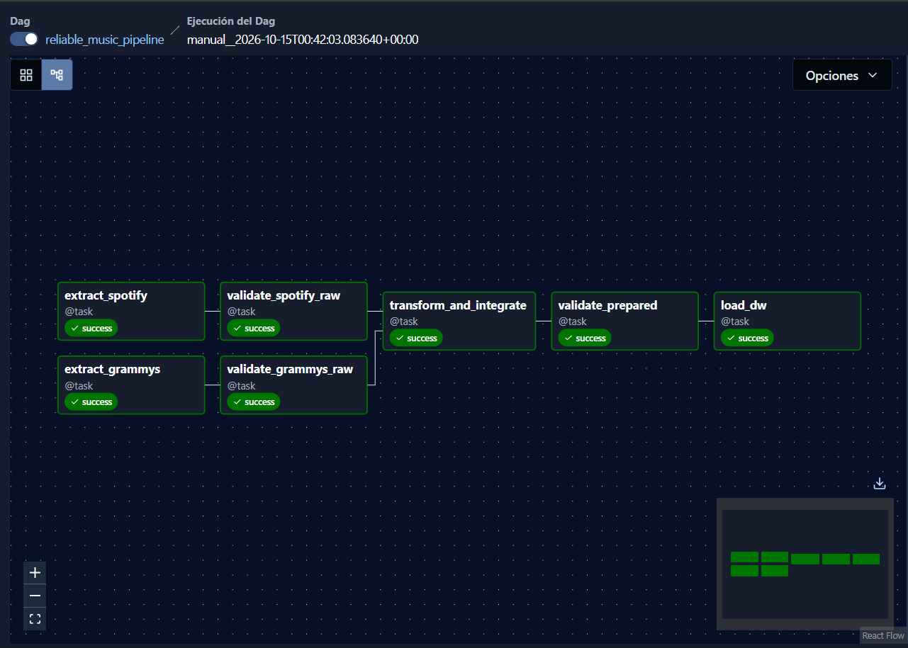
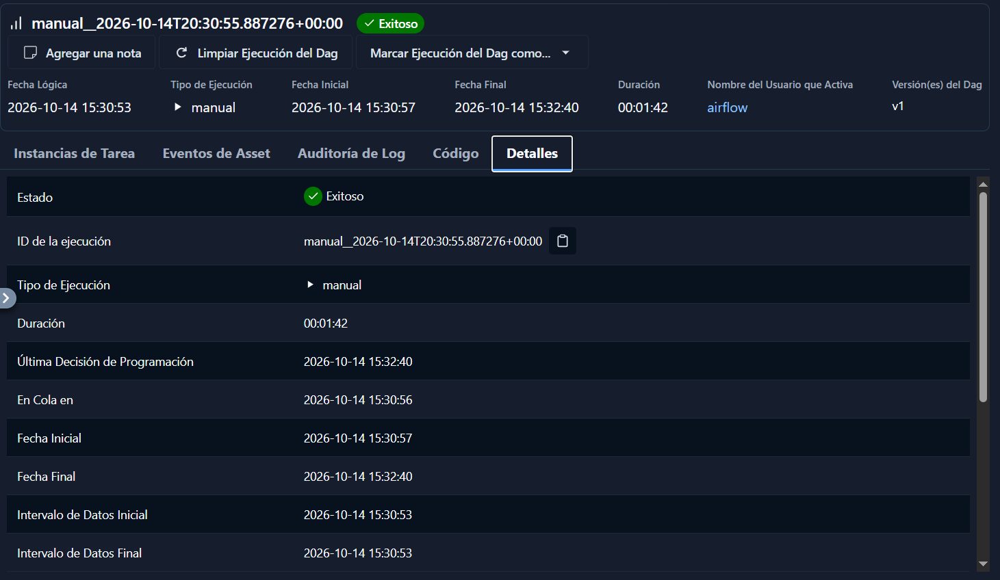


Validation JSONs for a successful batch are written under `data/validation_results/<batch_id>/`.

## 12. Test B. controlled critical failure

**Objective:** show that an invalid raw input fails a Critical gate, downstream tasks do not proceed normally, and the DW is not touched by that failed run.

The project includes a csv: `data/test/spotify_popularity_negativa.csv` that has a row with `popularity = -5` in the Spotify source. This violates DQ03.

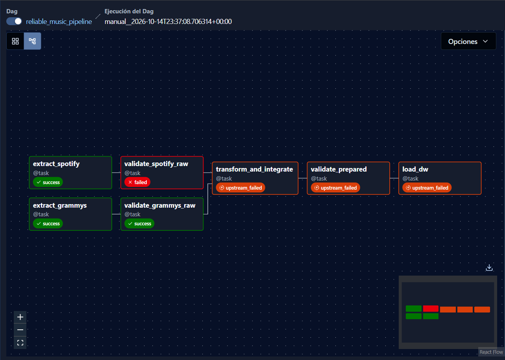

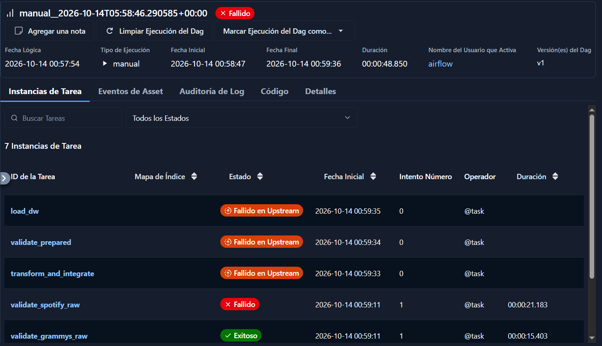

## 13. Repeatability and safe reruns

The loader uses one SQLAlchemy transaction (`engine.begin()`) and chunked `INSERT ... ON DUPLICATE KEY UPDATE` for dimension, fact, quarantine, and batch-control keys. The composite fact primary key is `(track_key, genre_key)`; `DIM_TRACK.track_id`, `DIM_ARTIST.artist_key_norm`, and `DIM_GENRE.track_genre` are unique business keys, `quarantine_spotify` has a unique `(source_row_id, reason)` key.

`main.py rerun-check` tests the direct CLI pipeline. It snapshots the rows in `FACT_TRACK_GENRE`, `DIM_TRACK`, `DIM_ARTIST`, `DIM_GENRE`, and `quarantine_spotify`, runs the ETL again via the CLI, then compares row counts and order-independent hashes of data columns. It excludes only configured audit fields (`etl_batch_id`, `loaded_at`, and quarantine-specific audit fields) from hashes and checks duplicate business keys. It prints the before/after results and writes `docs/evidence/rerun_check.txt`.

## 14. KPI views, dashboard, and traceability

### KPI view definitions and recommended visuals

| Analytical Requirement | DW Element / Query | KPI / Visualization |
|---|---|---|
| **R1. Genre concentration:** In which genres is the presence of artists with a Grammy record concentrated? | `dw.VW_KPI_BASE` and `dw.VW_KPI_1_GENRE_CONCENTRATION`; group by `track_genre` and use the artist-level `has_grammy_record` flag. | **K1:** Grammy-record share by genre: `AVG(has_grammy_record) × 100` for track–genre listings in each genre. Visual: sorted horizontal bar chart with genre on the axis and percentage on the value axis; tooltip shows total listings and Grammy-associated listings. A listing is counted in each genre under which its track appears. |
| **R2. Popularity and historical Grammy recognition:** Do artists who have won a Grammy (1958–2018) have higher popularity than those who have not, and does it grow with the number of awards? (association, not effect) | `dw.VW_KPI_2_POPULARITY_COMPARISON`, `dw.VW_KPI_3_TOP10_RATIO`, and `dw.VW_KPI_4_AWARD_BANDS`; uses listing-level `popularity`, artist award status/count, the batch-specific global Top-10% flag, and `wins_band`. | **K2:** mean and median popularity for `with_award` vs. `no_record` (grouped columns). **K3:** Top-10% popularity share for both groups and their ratio (percentage comparison plus ratio card). **K4:** mean and median popularity by award bands `1`, `2–4`, `5–9`, `10+` (line/point chart), with Top-10% share, distinct artists, listing count, and sample-size status in tooltips. |
| **R3. Zero popularity / zero-traction proxy:** What share of the catalog of artists with a Grammy record has zero traction (popularity = 0)? | `dw.VW_KPI_5_ZERO_TRACTION` and `dw.VW_KPI_6_ZERO_TRACTION_BY_GENRE`; uses `is_zero_traction`, artist Grammy-record status, and `track_genre`. | **K5:** percentage of listings with `popularity = 0` for `artists_with_grammy` vs. `rest_of_catalog` (paired KPI cards and bar chart). **K6:** percentage of zero-popularity listings among Grammy-associated listings by genre (sorted horizontal bar chart), with eligible listing count, zero-popularity count, and sample-size status in the tooltip. |

### End-to-end traceability matrix

| Requirement | Required data | Main quality risk | DQ rule / GX expectation | Transformation | DW element | KPI / visualization |
|---|---|---|---|---|---|---|
| R1–R3 | Spotify `track_id`, `track_name`, `album_name`, `artists`, `popularity`, `track_genre`; Grammy `year`, `category`, `nominee`, `artist` | Source schema changes / missing artist (RK02) | DQ01, GX01 and GX07 | Validate raw source before transformation, TD02 handles missing artist after gate | All prepared tables depend on source contract | K1–K6 use trusted DW data. |
| R1–R3 | Spotify's 20 data columns | RK01, 450 exact copies | DQ04 warning / GX05; DQ10 critical / GX14 | TD01, retain first copy | `FACT_TRACK_GENRE` composite key | K1–K6 avoid duplicate listing counts. |
| R1–R3 | Spotify `artists` | RK02 | DQ05 / GX06 | TD02 quarantines row as `missing_artist` | `quarantine_spotify`; row excluded from fact | Preserves valid artist foreign key. |
| R2,R3 | Spotify `popularity` | RK05/RK06; controlled `-5` case | DQ03 / GX04 | TD06 is only applied after raw gate passes | `FACT_TRACK_GENRE.popularity`, flags | K2: grouped columns comparing mean and median popularity by group. K3: Top-10% share comparison plus ratio card. K4: mean/median popularity by win band. K5: zero-popularity comparison by segment. K6: zero-popularity share by genre. |
| R2 | Grammy `year`, `winner` | RK07/RK08/RK11 | DQ08 / GX12 | TD04 stores historical rows and 2019 records separately | `DIM_ARTIST.grammy_wins_1958_2018`, `grammy_records_2019`, `grammy_status` | K2: grouped columns comparing with_award and no_record. K3: Top-10% share comparison and ratio card. K4: mean/median popularity by ordered win band (1, 2–4, 5–9, 10+), with sample-size status in the tooltip. |
| R1–R3 | Spotify primary artist and Grammy `artist`/limited `nominee` fallback | RK09/RK10/RK12/RK13 | DQ12/GX16/GX19; DQ14/GX20–GX23; DQ15/GX24 | TD03/TD05; normalize and aggregate Grammy by key before join | `DIM_ARTIST.has_grammy_record`, status and batch match metadata | K1: Grammy-associated listing share by genre (sorted horizontal bars). K2–K4: popularity by recognition status and win band. K5–K6: zero-popularity shares by segment and genre. |
| R2-R3 | Spotify popularity and batch p90 | RK05/RK06/RK14 | DQ13 / GX17–GX18 | TD06 derives both flags from popularity | `FACT_TRACK_GENRE.is_top10_global`, `.is_zero_traction`; `etl_control_batch.p90_popularity_threshold` | K3: Top-10% share comparison and ratio card. K4: popularity by win band with Top-10% share in tooltips. K5: zero-popularity share by segment. K6: zero-popularity share by genre. |
| R1–R3 | Raw rows, copies removed, quarantine count | RK01/RK02 | DQ11 / GX15 | TD01 + TD02 and reconciliation assertion | Fact count equals candidate count 113,549 in baseline | Ensures KPIs use reconciled data. |
| R1 | `artist_key_norm` and dimension keys | RK04/RK15 | DQ12 / GX16 and GX19 | TD03 normalizes primary artist and builds unique artist dimension | FK `FACT_TRACK_GENRE.artist_key` → `DIM_ARTIST.artist_key` | K1 and all artist-aware outputs. |

### Dashboard

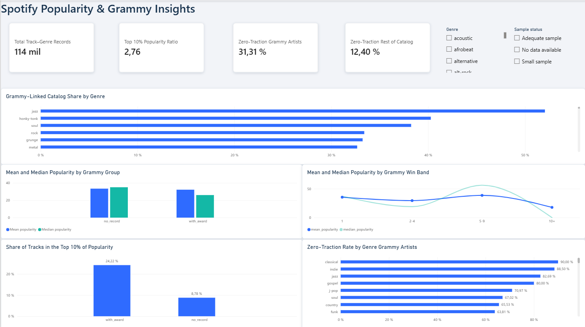

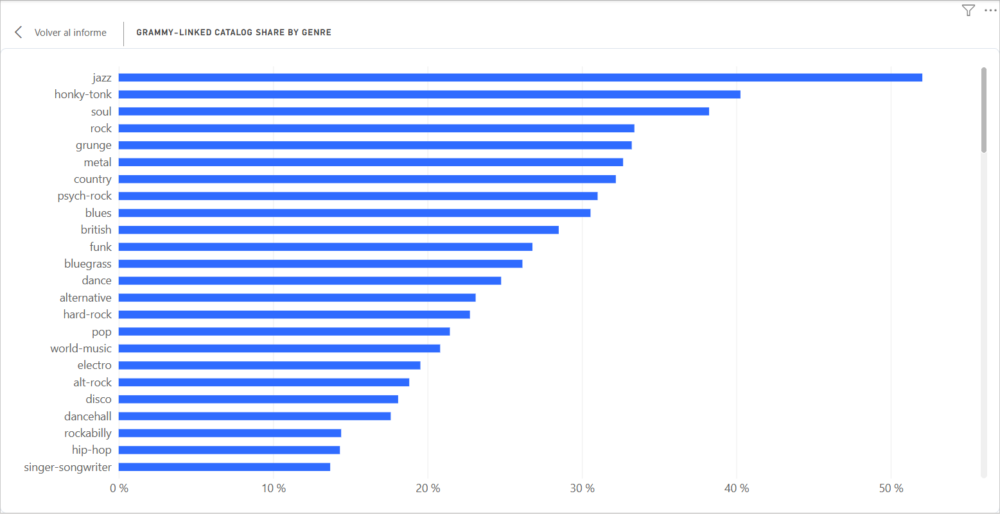

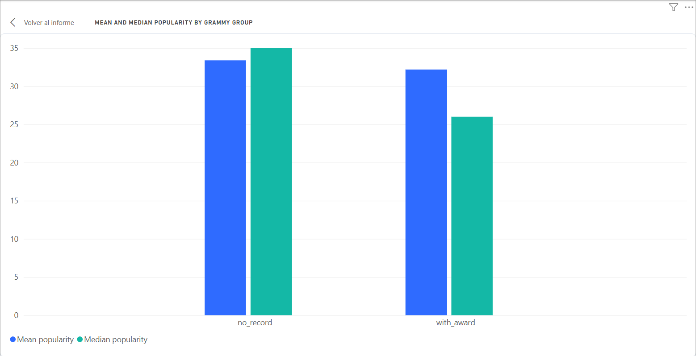

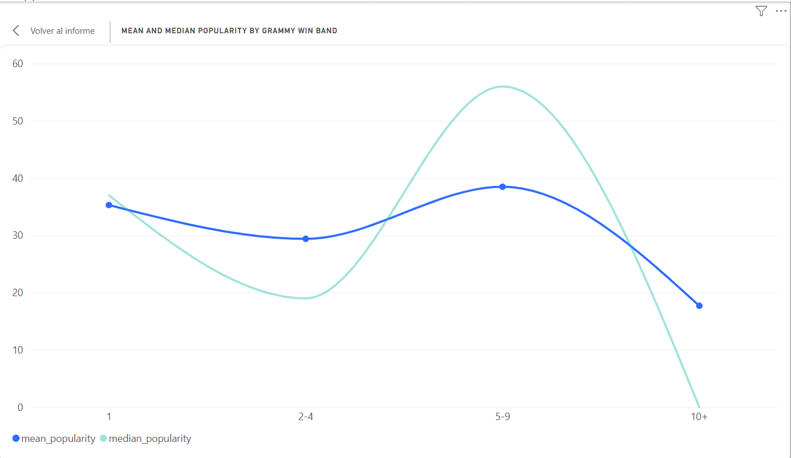

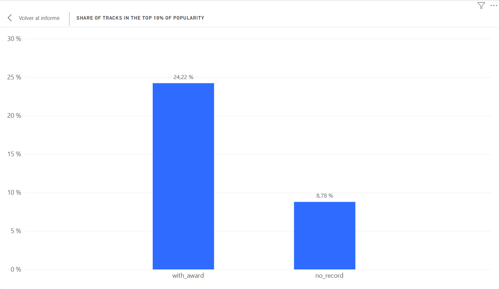

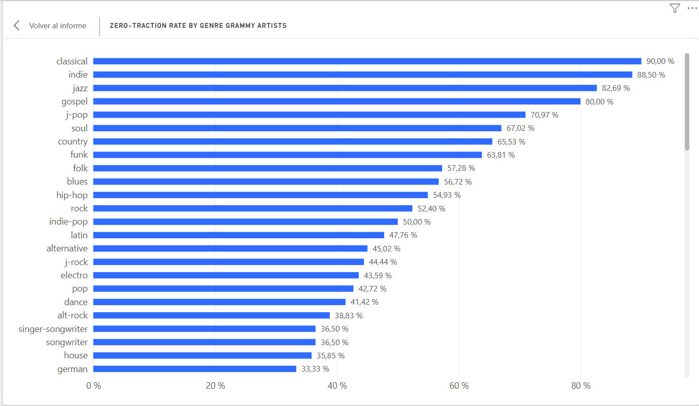

## 15. Setup and execution guide

```powershell
docker compose run --rm tools python main.py rerun-check
```

```json
{
  "spotify_path": "/opt/airflow/data/test/spotify_popularity_negativa.csv"
}
```

### Prerequisites

- Docker Desktop running with at least 4 GB of RAM available to Docker.
- Git and Windows CMD or PowerShell (commands below use PowerShell).
- Host ports `8080` (Airflow UI) and `3307` (MySQL) available.
- Source files present: `data/raw/spotify_dataset.csv` and `data/raw/the_grammy_awards.csv`.
- Python on the host only if running notebooks locally, ETL dependencies run in the Docker image.

### Configure the environment

The project provides preconfigured local credentials, so changing them is not necessary for the workshop to work and leaving them as they are is the most recommended step because the default usernames, passwords, database names, and connection settings are coordinated across the Docker Compose configuration, MySQL initialization script, and Python application, stil for good pracitce the .env is not submitted to the repository, so the command below is necessary to be executed.

```powershell
copy .env.example .env
```

### Initial setup

Build the image, start MySQL, and wait for its health check:

```powershell
docker compose build
docker compose ps
```

Prepare the Grammy source and create the Data Warehouse and also the views:

```powershell
docker compose run --rm tools python main.py prepare-source
docker compose run --rm tools python main.py create-dw
docker compose run --rm tools python main.py create-kpi-views
```

`prepare-source` truncates and reloads `grammy_source.grammy_awards` from the original Grammy CSV. It is an initial/source-reload step, not something to run automatically before every ETL run. `create-dw` creates the DW tables if missing; `reset-dw` is destructive and should only be used when intentionally resetting the target.

Optionally run tests:

```powershell
docker compose run --rm tools pytest tests/ -v
```

### Start Airflow and verify the environment

```powershell
docker compose up -d
docker compose ps
docker compose run --rm tools airflow version
```

Expected Airflow version: `3.1.8`. Open `http://localhost:8080` and use the local credentials configured for Airflow in `.env`. Do not assume they match MySQL or BI credentials.

### Test A — execute through Airflow

1. Find and unpause `reliable_music_pipeline` in the Airflow UI.
2. Click **Trigger DAG**.
3. Confirm all seven tasks reach `success` in Grid/Graph.
4. Open `load_dw` logs and run status:

```powershell
docker compose run --rm tools python main.py status
```

Save the screenshots described in §11.

### Create KPI views and cross-check

After the DW schema and a successful load:

```powershell
docker compose run --rm tools python main.py create-kpi-views
docker compose run --rm tools python main.py kpi-crosscheck
```

The cross-check calculates K1–K6 from DW tables with pandas, compares them with the MySQL views, and writes `docs/evidence/kpi_crosscheck_report.json` plus K4/K6 sample-alert CSVs. This command is separate from the DAG. The report is evidence for the execution timestamp it contains; regenerate it after changes to source, transformation, schema, or KPI SQL.

### Direct CLI pipeline (not an Airflow DAG Run)

The CLI path is useful for debugging and direct repeatability checks. It uses the shared stage functions, validates raw and prepared data, and only loads after the validation result permits it:

```powershell
docker compose run --rm tools python main.py run-pipeline
docker compose run --rm tools python main.py status
```

`run-pipeline` does not create Airflow task states in Grid/Graph. Use the Airflow UI for the assessed orchestration evidence. Other useful commands are:

| Command | Purpose |
|---|---|
| `prepare-source` | Load/reconcile Grammy CSV into the operational source table; replaces the source-table contents. |
| `create-dw` | Create the dimensional and control tables. |
| `reset-dw` | Drop/recreate DW tables; destroys current DW data but not Grammy source or Airflow metadata. |
| `create-kpi-views` | Create/replace SQL KPI views. |
| `kpi-crosscheck` | Compare pandas KPI calculations from DW tables to SQL views. |
| `make-test-batch` | Create `data/test/spotify_popularity_negativa.csv` with a synthetic `popularity=-5` row. |
| `rerun-check` | Re-run the direct CLI ETL and compare before/after row counts, data hashes, and business-key uniqueness. |
| `status` | Display Grammy source and DW row counts/status. |
| `extract`, `validate-raw`, `transform`, `validate-prepared`, `load` | Execute individual CLI stages for debugging. `load` requires a successful prepared-validation result for the batch. |

An interactive shell can be opened with `docker compose run --rm tools bash`. `--rm` removes that temporary `tools` container when you exit; it does not remove the persistent MySQL volume or source CSVs.

### Test B — controlled failure from Airflow

1. Create the bad input with `make-test-batch`.
2. In Airflow, select **Trigger DAG with config** and pass:

```json
{
  "spotify_path": "/opt/airflow/data/test/spotify_popularity_negativa.csv"
}
```

3. Verify `extract_spotify=success`, `validate_spotify_raw=failed`, `extract_grammys`/`validate_grammys_raw` independently complete if their source is healthy, and `transform_and_integrate`, `validate_prepared`, and `load_dw` are blocked/upstream-failed.
4. Compare DW status before and after; save the screenshots and failure log described in §12.

### Notebook profiling

For the raw CSV initial profile, install the separate notebook requirements in a local Python virtual environment:

```powershell
python -m venv .venv
.\.venv\Scripts\Activate.ps1
python -m pip install --upgrade pip
python -m pip install -r requirementsnotebook.txt
jupyter lab notebooks/initial_profiling.ipynb
```

That notebook reads the two CSVs independently and does not need MySQL. The detailed `notebooks/data_profiling.ipynb` uses the prepared Grammy source by default; start MySQL and run `prepare-source` before executing its database-connected Grammy cells.

### Reset and teardown

```powershell
# Stop containers but keep persistent database volumes
docker compose down

# Destructive full reset: removes persistent MySQL/Airflow database volumes
docker compose down -v
```

`docker compose down -v` removes database volumes; the source CSV files in `data/raw/` remain local, but the MySQL source table, DW contents, and Airflow metadata must be recreated/reinitialized.

## 16. Assumptions and limitations

### Grammy interpretation

- **2019 records are treated as a nominee list / no known outcome.** There are 433 rows over 84 categories (5–8 rows per category), while `winner` is `True` throughout all years. Real 2019 winners cannot be derived from the supplied data without external information.
- **1958–2018 rows are treated as historical award events.** There are 4,315 `(year, category)` pairs with one row and 31 with two rows. The two-row groups are treated as ties/shared awards, but this is an inference from the data, not externally verified for every case (for example, separate credited contributors).
- **Lead-artist Featuring rule:** if `artist` contains ` Featuring ` (case-insensitive), only the text before it is used as the key. Do not split on `&` or `With`, since these connectors can be part of a legitimate group name.
- The `winner` column is not used to determine awards because it has zero variance.

### Matching and normalization

- The sources have no shared artist ID. Homonyms can collapse into one normalized key, while aliases may fail to match; neither issue can be reliably solved without identity data.
- The exploratory profile's row-match rate and distinct matched-artist count use different denominators. The ETL's per-batch match metadata is the authoritative metric for DQ15 on a run.
- Grammy-only artists are not added as standalone `DIM_ARTIST` rows because the dimension is built from Spotify primary artists. Unmatched Grammy records are retained in source/metadata reconciliation counts.
- The Best New Artist `nominee` fallback is intentionally narrow; `nominee` can represent a song/work in other categories.

### Spotify and analytical semantics

- The exact-copy check compares all 20 data columns except the exported index; if the raw schema changes, this rule should be reviewed.
- Only missing/empty primary artist rows are quarantined as `missing_artist`; the observed row also lacks track and album names.
- p90 is recomputed for each batch. The observed value 63 belongs to the profiled snapshot and may change when the popularity distribution changes.
- `popularity = 0` is used as a zero-traction proxy; it is not the number of plays or revenue.
- Genre comparisons rely on a provided dataset with exactly 1,000 raw rows per genre. Row totals should not be interpreted as natural-market genre size.
- Secondary Spotify collaborators are not counted as separate artist links in the fact table (approximately 1.2% of observed collaborator credits had a secondary collaborator with a Grammy record in profiling).
- The current requirements do not include release-date analysis, song-level Grammy linking, audio-feature comparisons, or external genre/category mapping.

### Implementation and deployment

- The project runs on a single Docker host using Airflow LocalExecutor; this is a batch pipeline, not streaming ingestion.
- Airflow 3.1.8 and MySQL 8.0 are used. The configuration includes `SQL_ENGINE_COLLATION_FOR_IDS=utf8mb3_bin` to avoid Airflow internal ID index-length issues in the selected MySQL setup.
- The MySQL service is configured with local infile disabled; data loading uses Python/SQLAlchemy/PyMySQL chunked inserts, not `LOAD DATA`.
- `.env` contains local development configuration and must not be committed or included in the distributable archive. `.env.example` is the template; these credentials are not production credentials.


## 17. Repository structure

```text
workshop-2/
├── dags/
│   ├── reliable_music_pipeline.py       # Active Workshop-2 
├── data/
│   ├── raw/
│   │   ├── spotify_dataset.csv
│   │   └── the_grammy_awards.csv
│   ├── test/                            # Controlled DQ03 input
│   ├── work/                            # Per-batch Parquet files (runtime)
│   ├── validation_results/              # GX JSON by batch (runtime)
│   └── output/                          # KPI cross-check reports/alert CSVs
├── docs/
│   ├── evidence/                        # Evidence text/JSON/CSV/figures and screenshot placeholders
│   └── pipeline_architecture.mmd        # Editable pipeline 
├── gx/                                  # GX context and suites
├── notebooks/
│   ├── initial_profiling.ipynb           # Initial raw CSV 
│   ├── data_profiling.ipynb              # Detailed
│   └── data_profiling_exec.ipynb         # Executed copy
├── sql/
│   ├── source_setup.sql
│   ├── dw_schema.sql
│   └── kpi_queries.sql
├── src/                                  # Shared extraction, transform, validation, load, KPI modules
├── tests/
│   └── spotify_popularity_negativa.csv
│   
├── docker-compose.yaml
├── Dockerfile
├── main.py
├── requirements.txt
├── requirementsnotebook.txt
├── .env.example
└── README.md
```

---