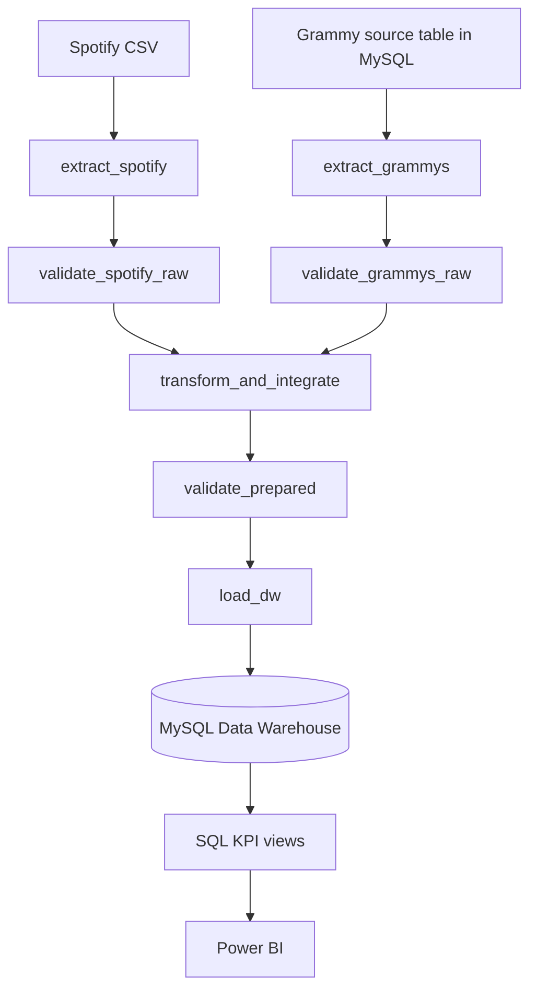

# Workshop 2 — Reliable Batch Data Pipeline

**Course:** ETL — Data Engineering and Artificial Intelligence (UAO)  
**Orchestrator:** Apache Airflow 3.1.8 (TaskFlow API)  
**Database:** MySQL 8.0  
**Data quality:** Great Expectations 1.23.1  
**Analytics:** MySQL KPI views and Power BI

This repository implements a batch ETL pipeline that integrates Spotify track listings with Grammy Awards records, validates data at raw and prepared gates, and loads a dimensional MySQL Data Warehouse. Airflow orchestrates the assessed workflow; Great Expectations evaluates quality rules; SQL views provide six KPIs for Power BI.

> **Engineering principle:** reliability means failures are anticipated, controlled, observable, and safe to recover from—not that failures never happen.

## Contents

1. [Problem, objective, and scope](#1-problem-objective-and-scope)
2. [Analytical requirements and KPIs](#2-analytical-requirements-and-kpis)
3. [Data sources](#3-data-sources)
4. [Pipeline architecture and responsibilities](#4-pipeline-architecture-and-responsibilities)
5. [Raw profiling findings and quality-risk catalogue](#5-raw-profiling-findings-and-quality-risk-catalogue)
6. [Quality rules and Great Expectations mapping](#6-quality-rules-and-great-expectations-mapping)
7. [Transformation and integration decisions](#7-transformation-and-integration-decisions)
8. [Dimensional model and data dictionary](#8-dimensional-model-and-data-dictionary)
9. [Airflow DAG design](#9-airflow-dag-design)
10. [Failure handling and retry policy](#10-failure-handling-and-retry-policy)
11. [Test A — successful run](#11-test-a--successful-run)
12. [Test B — controlled critical failure](#12-test-b--controlled-critical-failure)
13. [Repeatability and safe reruns](#13-repeatability-and-safe-reruns)
14. [KPI views, dashboard, and traceability](#14-kpi-views-dashboard-and-traceability)
15. [Setup and execution guide](#15-setup-and-execution-guide)
16. [Assumptions and limitations](#16-assumptions-and-limitations)
17. [Reliability evidence register and screenshot checklist](#17-reliability-evidence-register-and-screenshot-checklist)
18. [Repository structure](#18-repository-structure)

---

## 1. Problem, objective, and scope

Spotify provides a snapshot of track popularity, audio features, and genre. The Grammy dataset records names, categories, and years associated with Grammy Awards. The only usable integration attribute shared by the sources is artist name; neither source provides a common artist identifier.

The objective is to integrate the two sources into a trusted dimensional Data Warehouse and answer three analytical requirements while keeping source-quality issues visible and preventing invalid prepared data from being loaded.

**In scope**

- Read Spotify directly from the provided CSV.
- Load the provided Grammy CSV into a MySQL source table during source preparation, then extract Grammy from that relational table during ETL.
- Profile both datasets and translate observations into risks, rules, thresholds, and severity.
- Validate raw and prepared data with Great Expectations.
- Deduplicate Spotify exact copies, quarantine the row without an artist, normalize artist keys, enrich Spotify primary artists with Grammy-derived attributes, and calculate batch-specific popularity flags.
- Load the MySQL star schema transactionally and expose six DW-backed KPI views to Power BI.
- Demonstrate successful execution, a controlled critical failure, and safe reruns.

**Out of scope**

- Causal conclusions between Grammy recognition and Spotify popularity. The Spotify source has no date/year column.
- Song-level matching between Grammy nominees and Spotify tracks; there is no shared track/work identifier.
- Identifying actual 2019 Grammy winners from the supplied file. The `winner` column is `True` in every row.
- Expanding every secondary Spotify collaborator into a separate fact row; the integration uses the primary artist.
- External sources or an unsupported manual mapping between Spotify genres and Grammy categories.
- Using `workers`, `img`, `published_at`, or `updated_at` as KPI inputs.

## 2. Analytical requirements and KPIs

| ID | Analytical requirement | Required data | KPI(s) | Result / level of detail |
|---|---|---|---|---|
| **R1** | Which genres have a higher share of Spotify catalogue listings associated with artists who have a Grammy record? | Spotify `track_genre`, primary artist; Grammy-derived artist record/status | **K1** — share associated with Grammy-record artists by genre | Genre × listing; interpreted as a rate over track–genre fact rows, not unique artists. |
| **R2** | How does popularity differ between artists with historical Grammy records (1958–2018) and artists with no record, and how does it vary by award band? | Spotify `popularity`; artist-level `grammy_wins_1958_2018`, `grammy_status`, `wins_band` | **K2** — mean/median by group; **K3** — Top-10% share and ratio; **K4** — popularity and Top-10% share by award band | `with_award` vs `no_record`, then bands `1`, `2-4`, `5-9`, `10+`; `only_2019` is excluded from award-outcome comparisons. |
| **R3** | What share of listings has zero traction among Grammy-record artists versus the rest, and how does it vary by genre? | `popularity`, `is_zero_traction`, artist Grammy record flag, genre | **K5** — zero-traction share by segment; **K6** — zero-traction share by genre among Grammy-associated listings | Segment and genre; `popularity = 0` is a project-defined proxy for zero traction, not a direct stream/revenue measure. |

### KPI definitions used by the SQL views

| KPI | Definition | Interpretation / caution |
|---|---|---|
| **K1 — Grammy-record share by genre** | `AVG(has_grammy_record) * 100`, grouped by `track_genre` in `VW_KPI_BASE` | Share of fact listings in each genre linked to Grammy-record artists. It is not the share of distinct artists. |
| **K2 — Popularity comparison** | Mean and median `popularity` for `with_award` and `no_record` | Descriptive group comparison only; no causal inference. |
| **K3 — Top-10% share and ratio** | Percentage of each group with `is_top10_global = 1`; ratio = `with_award` percentage / `no_record` percentage | p90 is calculated for the current batch. It was 63 in the profiled snapshot. |
| **K4 — Award bands** | Mean, median, and Top-10% share by `wins_band` | Review `sample_status`; small bands require caution. |
| **K5 — Zero traction by segment** | `AVG(is_zero_traction) * 100` for `artists_with_grammy` and `rest_of_catalog` | `is_zero_traction = (popularity == 0)`. |
| **K6 — Zero traction by genre** | Zero-traction listings among Grammy-associated rows divided by all Grammy-associated listings in the genre | `no data` means denominator zero, not a rate of 0%. `small sample` means 1–29 Grammy-associated listings; `ok` means at least 30. |

SQL definitions are in `sql/kpi_queries.sql`. Creating the views (`create-kpi-views`) and comparing them with pandas (`kpi-crosscheck`) are separate commands; neither runs automatically when a DAG is triggered.

## 3. Data sources

| Source | Provided form | Observed shape | How the pipeline reads it | Path / table |
|---|---|---:|---|---|
| Spotify tracks | CSV, UTF-8 | 114,000 rows × 21 columns (20 data columns + exported index) | `extract_spotify` reads the file directly | `data/raw/spotify_dataset.csv`; container path `/opt/airflow/data/raw/spotify_dataset.csv` |
| Grammy Awards | CSV used for source preparation | 4,810 rows × 10 columns | `prepare-source` loads the CSV into MySQL; operational `extract_grammys` queries the MySQL source table, **not the CSV** | CSV: `data/raw/the_grammy_awards.csv`; table: `grammy_source.grammy_awards` |

Source preparation is not the final ETL load. `prepare-source` fills and reconciles the operational Grammy source table. `load_dw` writes validated prepared outputs into the dimensional Data Warehouse (`dw`). The raw CSVs are source inputs and must remain unchanged.

The source-preparation logic converts timestamp text to UTC-compatible MySQL DATETIME values, converts `winner` to a MySQL-compatible boolean value, converts empty fields to SQL `NULL`, inserts in chunks, and reconciles the imported row count in source-control metadata.

## 4. Pipeline architecture and responsibilities

> **Pipeline architecture source:** [`docs/pipeline_architecture.mmd`](docs/pipeline_architecture.mmd). The dimensional schema is a separate artifact; the existing [`docsWorkshop/star_schema.png`](docsWorkshop/star_schema.png) and [`docsWorkshop/star_schema.mmd`](docsWorkshop/star_schema.mmd) are preserved.



### Component responsibilities

| Component | Responsibility |
|---|---|
| `docker-compose.yaml` | Runs MySQL and Airflow services, mounts project data, and supplies environment variables. |
| `mysql` | Hosts Airflow metadata (`airflow_db`), the Grammy source (`grammy_source`), and the Data Warehouse (`dw`). |
| `dags/reliable_music_pipeline.py` | Defines the active seven-task Airflow DAG using `from airflow.sdk import dag, task`. |
| `src/extract.py` | Extracts Spotify and Grammy to batch-scoped Parquet; contains source-preparation logic for Grammy. |
| `src/validation.py` | Runs Great Expectations raw and prepared gates, writes result JSON, and blocks critical failures. |
| `src/transform.py` | Deduplicates, quarantines, normalizes, integrates, derives artist statuses and popularity flags, and writes prepared Parquet files. |
| `src/load.py` | Creates/resets DW schema and performs a transactional, chunked upsert of dimensions, fact, quarantine, and batch control. |
| `src/kpis.py` | Creates six SQL KPI views, recalculates KPIs from DW tables with pandas, compares calculations against SQL views, and writes cross-check evidence. |
| `main.py` | Administrative/verification CLI plus a direct end-to-end ETL command `run-pipeline`; this command does **not** create an Airflow DAG Run. |
| `gx/` | Persistent Great Expectations context, expectation suites, validation definitions, and checkpoints. |
| `sql/source_setup.sql`, `sql/dw_schema.sql`, `sql/kpi_queries.sql` | Source DDL, dimensional/control DDL, and DW KPI views. |

## 5. Raw profiling findings and quality-risk catalogue

The raw profiling meets the categories required by Workshop-2 §6.3: structure, completeness, uniqueness/duplication, categorical content, numerical content, temporal content, and cross-source consistency. Profiling describes the data; it does not clean source files or substitute for GX validation.

Two notebooks have different purposes:

- `notebooks/initial_profiling.ipynb`: basic exploratory profiling of both raw CSVs locally; does not need MySQL and does not change either file.
- `notebooks/data_profiling.ipynb`: the detailed Workshop-2 profile; Spotify is read from its CSV, while Grammy is read from `grammy_source.grammy_awards` by default. It is read-only for the source database and checks that the Spotify CSV hash is unchanged. The executed copy is `notebooks/data_profiling_exec.ipynb`.

The documented shared artist normalizer is `normalize_artist_name()` in `src/transform.py`: Unicode NFKD normalization, removal of combining marks, lowercasing, punctuation removal while preserving word/space characters, whitespace collapse, and trimming. Empty normalized values are not valid integration keys. The profile review notes 29,858 Spotify individual artist tokens and 29,757 normalized keys for one executed normalization pass; use actual current-code outputs when presenting a later rerun.

### Main observed findings

| Dataset / attribute | Observed finding | Engineering implication |
|---|---|---|
| Spotify structure | 114,000 × 21; 20 business/data columns plus `Unnamed: 0` export index | Drop the export index during transformation; do not treat it as a business key. |
| Spotify completeness | Three null cells in one row: `artists`, `album_name`, `track_name`; its `track_id` is `1kR4gIb7nGxHPI3D2ifs59` | The missing-primary-artist row is quarantined with `missing_artist`. |
| Spotify exact copies | 450 extra exact copies across the 20 data columns; 444 duplicate groups; 894 rows involved when both originals and copies are counted | Exclude `Unnamed: 0` from exact-equality comparison; deduplicate in TD01. |
| Spotify track and genre | 89,741 distinct `track_id`; 16,299 tracks occur in multiple genres (23,809 cross-genre repeated rows) | `track_id` alone is not the fact grain; preserve track × genre. |
| Spotify duplicate candidate key | After exact-copy removal, no `(track_id, track_genre)` pair remains repeated | DQ10 protects the prepared fact grain. |
| Spotify popularity conflicts | 720 tracks have differing popularity across repeated genre listings | Do not collapse rows by `track_id` alone; the fact grain retains genre listing variation. |
| Genre sampling | 114 genres, exactly 1,000 raw rows per genre | Raw row counts reflect the provided sampling design; interpret rates with this limitation. |
| Artist credits | 26.4% of rows contain 2+ artists separated by `;`, up to 38 credits | Use primary artist consistently and preserve the original artist credit string. |
| Popularity distribution | Mean 33.2; median 35; p25 17; p75 50; p90 63; p99 80 | Compute p90 per batch; 63 is the observed snapshot value, not a hard-coded permanent threshold. |
| Zero popularity | 14.05% have popularity 0 compared with 1.88% at popularity 1 | Define and validate the zero-traction proxy explicitly. |
| Audio domains | 90 rows have `loudness > 0`; 157 rows have `tempo <= 0`; 82 duration values are outside 1 ms–20 min; 1,136 rows have `time_signature` outside 3–7 | Sentinel or implausible values may affect optional audio summaries; audio-feature analysis is out of scope for KPIs. |
| Spotify temporal coverage | No date/year/timestamp column | Cannot align popularity before/after Grammy years. |
| Grammy structure | 4,810 × 10; years 1958–2019, 62 years, no year nulls | Reconcile extracted count with source-import control. |
| Grammy artist completeness | 1,840 null `artist` values (38.3%); 1,758 are in 246 categories that never have a populated `artist`; `Song Of The Year` has 70/70 null | Nulls are partly structural; do not assume `nominee` is an artist in every category. |
| Grammy other nulls | `workers`: 2,190 nulls (45.5%); `img`: 1,367 (28.4%); `nominee`: 6 | `workers` and `img` are profiled but not KPI inputs. |
| Grammy winner flag | `winner` is `True` in all 4,810 rows (MySQL value `1`) | Zero variance; never use this column to distinguish winners from nominees. |
| Grammy 2019 pattern | 433 rows across 84 categories; group sizes are 5–8 per category | Project assumption: 2019 rows are a nominee list / records with no known outcome, not confirmed wins. |
| Grammy historical pattern | 4,346 `(year, category)` groups for 1958–2018; 4,315 have one row and 31 have two rows | Double rows are treated as ties/shared records by assumption, not exact duplicates. |
| Grammy category labels | 638 raw category labels, 629 after normalization; two rows with extra spaces | Normalize category labels before grouping. |
| Best New Artist | 66 records across 8 category spellings; 65 have null `artist`, where `nominee` supplies the artist name | Apply the nominee fallback only to Best New Artist when `artist` is empty. |
| Generic artist marker | 66 Grammy rows use `(Various Artists)`; Spotify has one occurrence not in primary-artist position | Exclude the generic marker from artist matching. |
| Artist name matching | No shared artist ID; matches depend on Unicode normalization and documented lead-artist/Best New Artist handling | Homonyms cannot be distinguished with the available data. A unique-artist count and a matched-row rate use different denominators and must not be mixed. |
| Grammy timestamps | All timestamp text is parseable; offsets include `-08:00` and `-07:00`; `published_at` year agrees with award `year` in only 1.8% | These are website publication/update dates, not award event dates. |
| Genre vs category | Spotify has 114 genre labels and Grammy has 638 raw categories (629 normalized); no supplied shared vocabulary/key | Do not invent a genre-to-category bridge. |

Existing profile figures in `docs/evidence/` include `spotify_popularity_distribution.png`, `spotify_exact_copies_by_genre.png`, `spotify_artists_per_row.png`, `grammy_rows_by_year.png`, `grammy_source_grain.png`, and `grammy_artist_match_steps.png`. The CSV `docs/evidence/profiling_evidence_section_6_3.csv` contains the evidence table used for §6.3.

### Detailed profiling evidence for Workshop-2 §6.3

The table below consolidates the detailed row-level findings that support the risk catalogue. The companion CSV `docs/evidence/profiling_evidence_section_6_3.csv` is retained as machine-readable evidence. The raw profiling itself is descriptive: it reports observations and does not apply ETL cleaning or GX pass/fail policy.

| Dataset / attribute                           | Profiling evidence                                                                                                                                                                                                                                                                                                                                                                                                                                                        | Potential quality risk                                                                                                                                                                        | Related requirement          |
|:----------------------------------------------|:--------------------------------------------------------------------------------------------------------------------------------------------------------------------------------------------------------------------------------------------------------------------------------------------------------------------------------------------------------------------------------------------------------------------------------------------------------------------------|:----------------------------------------------------------------------------------------------------------------------------------------------------------------------------------------------|:-----------------------------|
| Spotify / complete table                      | Structure: 114,000 rows × 21 columns (20 data columns + unnamed index); profile types {'decimal': 9, 'integer': 6, 'text': 5, 'boolean': 1}. Completeness: 3 null cells across artists, album_name, track_name; all on 1 row.                                                                                                                                                                                                                                             | Completeness: row without artist, album, or title cannot be assigned to an artist.                                                                                                            | R1–R3                        |
| Spotify / Unnamed: 0                          | Structure: blank first header cell=True; values 0…113999 (114,000 unique); equals row number=True.                                                                                                                                                                                                                                                                                                                                                                        | Uniqueness: export artifact, not a business key; uniqueness can hide exact copies unless this column is excluded.                                                                             | — (traceability)             |
| Spotify / track_id                            | Structure: 22-character alphanumeric pattern 100.00%; completeness: 0 nulls. Uniqueness: 89,741 distinct IDs in 114,000 rows; 24,259 excess rows = 450 exact copies + 23,809 cross-genre repeats (16,299 tracks span 2–9 genres). Numeric consistency: 720 tracks have differing popularity across rows.                                                                                                                                                                  | Exact copies break track × genre grain; one track may have different popularity on different genre rows.                                                                                      | R1–R3                        |
| Spotify / track_genre                         | Categorical: 114 lowercase genres, 0 edge-space rows; rows per genre 1000–1000. Completeness: 0 nulls; after copy removal each genre has 904–1000 rows.                                                                                                                                                                                                                                                                                                                   | Validity: a fixed 1,000-row split per genre is a sample, not a measure of real catalog volume.                                                                                                | R1, R3                       |
| Spotify / artists                             | Completeness: 1 null. Multivalued structure: 26.4% of rows have 2+ credited artists (max 38); 31,437 artist-list strings -> 29,858 individual names. Categorical: 1,974 individual names contain non-ASCII characters; 47 case-only collisions; 8 edge-space occurrences.                                                                                                                                                                                                 | Consistency: select first credited artist as primary; normalization should be Unicode-aware and tolerate case/spacing.                                                                        | R1–R3                        |
| Spotify / album_name, track_name              | Completeness: 1 album null and 1 title null on the same row. Categorical: 46,589 distinct albums, 73,608 distinct titles; 7,991 titles are shared by 2+ track IDs (maximum 48: "Rockin' Around The Christmas Tree").                                                                                                                                                                                                                                                      | Uniqueness: track title is not a unique key and must not replace track_id.                                                                                                                    | — (descriptive)              |
| Spotify / popularity                          | Numeric: integer 0–100; 0 out of range; mean 33.2, median 35, p25/p75/p90/p99=17/50/63/80; rows at 100: 2. Score 0 share 14.05% vs score 1 1.88%.                                                                                                                                                                                                                                                                                                                         | Validity: zero is the scale floor, not missingness; popularity is an undated relative snapshot. Global top-decile cutoff is >= 63 with 10.06% coverage.                                       | R2, R3                       |
| Spotify / duration_ms                         | Numeric: 0.0 to 87.3 minutes; median 3.5 minutes, p99 8.8 minutes; 1 rows at zero; >10 min 603, >20 min 81, >60 min 16.                                                                                                                                                                                                                                                                                                                                                   | Validity: zero duration is implausible; very long values may be mixes or full-album uploads.                                                                                                  | —                            |
| Spotify / explicit, mode, key                 | Categorical: explicit=True 8.6%; mode=1 63.8%; key range 0–11. Completeness: no null issue in these fields.                                                                                                                                                                                                                                                                                                                                                               | No material quality finding in the observed profile.                                                                                                                                          | —                            |
| Spotify / seven audio features                | Numeric: danceability, energy, speechiness, acousticness, instrumentalness, liveness, valence all have 0 values outside [0,1] across all seven. instrumentalness median 0.00, zero 34.0%, >0.5 16.5%. 157 rows share zeros in tempo, danceability, speechiness, valence, and time_signature.                                                                                                                                                                              | Validity: block of 157 zero audio profiles is consistent with an audio-analysis failure, not a real signal.                                                                                   | —                            |
| Spotify / loudness                            | Numeric: -49.5 to 4.5 dB; mean -8.3; 90 rows above 0 dB and 38 below −40 dB.                                                                                                                                                                                                                                                                                                                                                                                              | Validity: values above 0 dB and very low extremes merit verification.                                                                                                                         | —                            |
| Spotify / tempo                               | Numeric: 0–243.4 BPM; mean 122.1; 157 rows at zero (same as the zero-audio block); 8 above 220 BPM.                                                                                                                                                                                                                                                                                                                                                                       | Validity: tempo=0 is not musically plausible and likely a sentinel value.                                                                                                                     | —                            |
| Spotify / time_signature                      | Categorical counts: {0: 163, 1: 973, 3: 9195, 4: 101843, 5: 1826}; 163 rows have 0, of which 157 overlap tempo=0. Values 2, 6 and 7 are absent.                                                                                                                                                                                                                                                                                                                           | Validity: 0 is not a valid time signature; most zero values coincide with the zero-audio block.                                                                                               | —                            |
| Grammy / complete table                       | Structure: 4,810 rows × 10 columns read from MySQL table grammy_source.grammy_awards. Actual MySQL column types are shown in Section 2.2. Per source preparation, published_at and updated_at are stored as UTC DATETIME with the original offset suffix removed; winner is stored as 1/0. Completeness: nulls {'nominee': 6, 'artist': 1840, 'workers': 2190, 'img': 1367}. Uniqueness profile: full-row duplicate count 0; (year, category, nominee) duplicate count 0. | Uniqueness: the natural candidate key includes nominee, which is null in 6 source records.                                                                                                    | R1–R3                        |
| Grammy / year                                 | Temporal: 1958–2019; 62 years, missing years []; rows/year min 28, median 75, max 433 (433 records in 2019, 9.0%).                                                                                                                                                                                                                                                                                                                                                        | Consistency: 2019 accounts for ~9% of rows and has a different source grain from 1958–2018.                                                                                                   | R2                           |
| Grammy / title                                | Categorical: 62 distinct titles, one per year=True; annual-title pattern with two spaces matches 100%; ordinal and parenthetical years agree with year=True / True.                                                                                                                                                                                                                                                                                                       | Redundant with year; double space is a small formatting inconsistency.                                                                                                                        | —                            |
| Grammy / published_at, updated_at             | Temporal: stored UTC DATETIME values parseable 4810/4810 and 4810/4810; original CSV timezone suffixes are not present in the source table. Max distinct timestamp per award year 1 published / 1 updated; total distinct values 4 / 10; published_at range 2017-11-28–2020-05-19; updated_at range 2017-11-28–2020-09-01; updated < published in 0 rows; published year agrees with award year in 1.8%.                                                                  | Temporal semantics: timestamps refer to website publication/update, not award event dates; don't use as business event dates.                                                                 | —                            |
| Grammy / category                             | Categorical: 638 raw labels -> 629 normalized; whitespace anomalies 2; top categories [('Song Of The Year', 70), ('Record Of The Year', 69), ('Album Of The Year', 66)]; single-row categories 224, with <=5 rows 385. Completeness: no nulls.                                                                                                                                                                                                                            | Consistency: spellings vary and award categories change over time; Best New Artist handling must account for variants.                                                                        | R1–R3 (Best New Artist rule) |
| Grammy / nominee                              | Completeness: 6 nulls (Best New Country & Western Artist (1965); Best New Country & Western Artist Of 1964 (1964); Remixer Of The Year, Non-Classical (1997–1999); Remixer Of The Year, Non-classical (1998); Remixer of the Year, Non-Classical (2000)). Categorical: 4,131 distinct non-null values; whitespace anomalies 7. Meaning can be a work title or a person depending on category.                                                                             | Validity: nominee does not always denote an artist, so only the specific Best New Artist rule may use it as one.                                                                              | R1–R3 (Best New Artist only) |
| Grammy / nominee + category (Best New Artist) | Cross-source: 66 rows in 8 category spellings; artist is null in 65 rows; nominee matches a Spotify primary key in 32. Outside this family, 1,769 rows have artist null and nominee present; 28 such nominees happen to match a Spotify artist.                                                                                                                                                                                                                           | Consistency: nominee is an artist name only for Best New Artist; using it generally would create false or uncertain artist relationships.                                                     | R1–R3 (Best New Artist rule) |
| Grammy / artist                               | Completeness: 1,840 nulls (38.3%); 1,758 in 246 categories that always omit artist. Song Of The Year: 70/70 null. Categorical: 1,658 distinct, Featuring=86, '&'=411, With=20; non-ASCII rows=99.                                                                                                                                                                                                                                                                         | Completeness: nulls are structural, not random. Consistency: one string may combine multiple credited artists.                                                                                | R1–R3                        |
| Grammy / workers                              | Completeness: 2,190 nulls (45.5%). Free-text credits: 1,132 semicolon strings; 1,400 with parentheses; 1,366 of artist-null rows have parentheses in workers.                                                                                                                                                                                                                                                                                                             | Validity: free-text mixes credits and roles; could be a secondary clue where artist is missing but should not be silently parsed as a clean key.                                              | — (optional)                 |
| Grammy / img                                  | Completeness: 1,367 nulls (28.4%). Categorical: 3,443 HTTPS URLs; 1,463 distinct non-null URLs (URLs repeat).                                                                                                                                                                                                                                                                                                                                                             | No material analytical use for the requested KPIs; profile for completeness only.                                                                                                             | —                            |
| Grammy / winner                               | Categorical: pandas dtype int64; stored database values {1: 4810}. Source preparation converts CSV True/False to MySQL boolean-compatible 1/0; in this observed table all stored values represent True.                                                                                                                                                                                                                                                                   | Semantics: the observed constant value does not distinguish winners from nominees; the notebook does not use this field to infer outcomes.                                                    | R2 (award assumption)        |
| Grammy / year × category (source grain)       | Uniqueness: 1958–2018 has 4,346 combinations with sizes {1: 4315, 2: 31}; 2019 has 433 rows across 84 categories, group sizes {5: 79, 6: 1, 8: 4}; Record Of The Year 2019 has 8 nominees, stored winner values={'1'} (1 represents True).                                                                                                                                                                                                                                | Consistency: 1958–2018 appears to list award results; 2019 is a nominee list, so row grain differs. Historical interpretation remains an inference.                                           | R2                           |
| Both / artist integration key                 | Cross-source: no shared ID; names only. Spotify 29,858 names -> 29,757 keys (99 multi-spelling keys); Grammy 1,658 artist strings -> 1,646 keys. 539 Grammy keys appear in Spotify; 1429 rows have a non-generic any-credit match; 483 of 17622 Spotify primary artists have a Grammy match.                                                                                                                                                                              | Consistency: name matching is vulnerable to homonyms and variants; multiple people may be merged into one string; most catalog artists have no counterpart.                                   | R1–R3                        |
| Both / artist matching (resolvable rows)      | Cross-source: 1,199 of 2,969 resolvable Grammy rows (excluding Various Artists) match a Spotify primary artist: 40.4%. Step rates: {'A. Raw artist text': 1078, 'B. + Unicode normalization': 1117, 'C. + split Featuring credits': 1167, 'D. + Best New Artist nominee rule': 1199}.                                                                                                                                                                                     | Consistency: match coverage depends on the available names, the scope of each catalogue, normalization, and handling of Featuring and Best New Artist; a text match is not proof of identity. | R1–R3                        |
| Both / "Various Artists"                      | Cross-source: 66 Grammy rows have artist='Various Artists'; Spotify has 1 rows with this credit, 0 as primary artist.                                                                                                                                                                                                                                                                                                                                                     | Consistency: generic marker could create false matches if matching any credited artist; exclude it from match denominator and keys.                                                           | R1–R3                        |
| Both / time                                   | Temporal: Spotify has no date/year field; Grammy `year` spans 1958–2019; `popularity` is an undated snapshot.                                                                                                                                                                                                                                                                                                                                                             | Temporal consistency: popularity cannot be aligned before/after an award event with these sources.                                                                                            | R2                           |
| Both / genre versus category                  | Cross-source: Spotify has 114 genres; Grammy has 638 raw categories (629 after normalization); no shared ID or directly equivalent vocabulary.                                                                                                                                                                                                                                                                                                                            | Consistency: there is no supported genre-to-award-category bridge; do not introduce external/manual mappings.                                                                                 | R1                           |

**Matching-statistic note:** profiling artefacts report more than one matching statistic because they use different matching steps, keys, or denominators. For example, the row-level exploratory method reports 1,199/2,969 resolvable Grammy rows (40.4%), while one Section 6.3 table reports 483/17,622 Spotify primary artists. These are different units and must not be treated as interchangeable. For DQ15, use the actual per-batch `grammy_match_rate_pct` emitted by the ETL. If reporting a particular exploratory number, name its numerator, denominator, method, and profiling version.

### Quality-risk catalogue RK01–RK15

| Risk | Profiling finding | Potential impact | Pipeline handling |
|---|---|---|---|
| **RK01** | 450 Spotify exact extra copies, 444 groups, 894 implicated rows | Inflated fact counts and double-counted measures | DQ04 warning; TD01 removes exact copies. |
| **RK02** | One row missing `artists`, `album_name`, and `track_name` | Cannot link a fact row to an artist | DQ05 gate policy; TD02 quarantines as `missing_artist`. |
| **RK03** | 89,741 distinct track IDs; tracks span multiple genres | `track_id` alone is not a unique listing key | Fact grain is `(track_key, genre_key)`; DQ10 validates prepared grain. |
| **RK04** | 26.4% rows have multiple artist credits | Expanding all artists could cause fact row explosion | TD03 uses primary artist; preserve `artists_raw`/`n_artists`. |
| **RK05** | 14.05% popularity zeros | Zero cohort affects distribution and traction analysis | TD06 derives `is_zero_traction`; K5/K6 report it. |
| **RK06** | Observed p90 popularity is 63 | Static threshold becomes stale if data distribution changes | Recompute p90 for every batch; verify flag consistency with DQ13. |
| **RK07** | Grammy `winner` is always True | The field cannot distinguish winners | Ignore `winner` for win counting; apply the documented year-based assumption. |
| **RK08** | 2019 contains 433 rows in 84 categories, 5–8 per category | Treating each as a confirmed win overstates awards | Store `grammy_records_2019` separately and exclude from historical-win count. |
| **RK09** | `artist` null in 1,840 Grammy records; Best New Artist has a special fallback | Many records cannot be matched from `artist` alone | TD05 uses `nominee` only for Best New Artist with empty `artist`. |
| **RK10** | 66 Grammy rows use `(Various Artists)` | False positive generic-name match | Exclude the generic marker. |
| **RK11** | 31 historical `(year, category)` groups have two rows | Award-count interpretation may overcount some co-credits | Treat each source row as an award event under the documented tie/shared-record assumption. |
| **RK12** | Matching is text-based with no shared artist ID | Homonyms can merge; aliases may fail to link | Record limitation and matching metrics; do not claim perfect entity resolution. |
| **RK13** | Only a subset of resolvable Grammy records maps to Spotify primary artists | Changing match coverage may affect R1–R3 | DQ15 enforces per-batch match-rate threshold; record denominator/results in batch metadata. |
| **RK14** | 720 track IDs have differing popularity across genre listings | Deduplicating by track ID would discard source variation | Preserve track × genre grain. |
| **RK15** | Normalized artist business key must be unique | Duplicate keys break dimension and foreign-key integrity | DQ12 plus unique constraint on `DIM_ARTIST.artist_key_norm`. |

**Matching metric clarification:** the profiling review reports 1,199 of 2,969 resolvable Grammy rows matched (40.4%) under its exploratory matching sequence, and about 462 distinct Spotify primary artists with Grammy matches. Those values describe different units. The pipeline calculates its own per-batch `grammy_match_rate_pct` from the transformation metadata; use that batch report for the actual DQ15 result rather than treating an exploratory notebook statistic as an interchangeable denominator.

## 6. Quality rules and Great Expectations mapping

The implementation defines 15 rules (DQ01–DQ15). Severity is an engineering policy linked to source contracts, profiling risks, analytical requirements, and prepared-data invariants.

### DQ rules

| Rule | Layer / attributes | Quality dimension and rule | Metric / threshold | Severity | Related requirement / rationale |
|---|---|---|---|---|---|
| **DQ01** | Both raw sources: required columns | Validity/structure: all required columns must exist; extra exported index is allowed | Required set present | Critical | Source contract for R1–R3. |
| **DQ02** | Spotify `track_id`, `track_genre` | Completeness: identifiers and genre are non-null | 100% non-null | Critical | Protects fact grain. |
| **DQ03** | Spotify `popularity` | Validity: non-null integer in range | 0–100 inclusive | Critical | A negative value is Test B. |
| **DQ04** | Spotify `(track_id, track_genre)` | Uniqueness: repeated pairs are reported in raw data | No repeats expected; known issue is Warning | Warning | Expected source issue; exact copies are removed in TD01. |
| **DQ05** | Spotify `artists` | Completeness: artist present for link to Grammy; missing rows are quarantined after raw validation | `mostly=0.99` (at least 99% non-null) | Critical gate with tolerance | Observed single missing-artist row is within the allowed failure proportion; quarantined during transformation. |
| **DQ06** | Grammy `year`, `category` | Completeness/validity: required fields present; year in observed allowed domain | `year` in 1958–2019, non-null; `category` non-null | Critical | Protects award era/category. |
| **DQ07** | Grammy whole table | Consistency/completeness: extracted row count equals source import-control count | Difference = 0 | Critical | Proves extraction from MySQL source was reconciled with preparation. |
| **DQ08** | Grammy `year`, `category` | Consistency: in 1958–2018 each group has at most two rows; 2019 receives special handling | Max group size 2 for historical years; 2019 helper value 1 | Critical | Protects source-grain assumption. |
| **DQ09** | Prepared datasets | Validity/structure: required columns and types match the model | 100% schema contract | Critical | Applies to prepared fact and dimensions. |
| **DQ10** | Prepared Spotify fact | Uniqueness: no duplicate track–genre key | 0 duplicate `(track_id, track_genre)` pairs | Critical | One row per listing after transformation. |
| **DQ11** | Prepared row counts | Completeness/consistency: candidate rows equal raw minus exact copies and quarantine | Difference = 0 | Critical | Baseline: 114,000 − 450 − 1 = 113,549. |
| **DQ12** | Prepared artist key and reference | Consistency: primary artist key exists and is unique in `DIM_ARTIST` | 100% fact artist key non-null; unique `artist_key_norm` | Critical | Protects artist matching and FK integrity. |
| **DQ13** | Prepared `popularity`, `is_zero_traction`, `is_top10_global` | Validity/consistency: derived flags agree with popularity and current p90 | 100% coherent | Critical | `is_zero_traction = (popularity == 0)`; top-10 flag = `popularity >= p90`. |
| **DQ14** | `DIM_ARTIST` Grammy attributes | Validity/consistency: status, wins band, record flag, counts, and derived status agree | Allowed enum values and coherent values | Critical | Protects R1–R3 interpretations. |
| **DQ15** | Prepared Grammy-to-Spotify match metadata | Consistency/coverage: match rate over resolvable Grammy rows must meet minimum | At least 10% | Critical | Custom Python assertion; uses cross-dataset metadata. |

### Great Expectations suite and gate mapping

Great Expectations Core 1.23.1 uses a persistent file-based context under `gx/`. The table below preserves the implemented GX-to-DQ mapping.

| GX ID | DQ rule | Suite / gate | Expectation or check | Target | Severity / notes |
|---|---|---|---|---|---|
| GX01 | DQ01 | `spotify_raw` | `ExpectTableColumnsToMatchSet` | Required Spotify columns; extra index allowed | Critical; `exact_match=False`. |
| GX02 | DQ02 | `spotify_raw` | `ExpectColumnValuesToNotBeNull` | `track_id` | Critical. |
| GX03 | DQ02 | `spotify_raw` | `ExpectColumnValuesToNotBeNull` | `track_genre` | Critical. |
| GX04 | DQ03 | `spotify_raw` | `ExpectColumnValuesToBeBetween` | `popularity`, min 0, max 100 | Critical. |
| GX05 | DQ04 | `spotify_raw` | `ExpectCompoundColumnsToBeUnique` | `track_id`, `track_genre` | Warning; expected raw warning; 894 implicated rows / 450 copies in baseline. |
| GX06 | DQ05 | `spotify_raw` | `ExpectColumnValuesToNotBeNull` | `artists`, `mostly=0.99` | Critical gate with documented tolerance. |
| GX07 | DQ01 | `grammy_raw` | `ExpectTableColumnsToMatchSet` | `year`, `category`, `nominee`, `artist` | Critical; extra columns allowed. |
| GX08 | DQ06 | `grammy_raw` | `ExpectColumnValuesToNotBeNull` | `year` | Critical. |
| GX09 | DQ06 | `grammy_raw` | `ExpectColumnValuesToBeBetween` | `year`, 1958–2019 | Critical. |
| GX10 | DQ06 | `grammy_raw` | `ExpectColumnValuesToNotBeNull` | `category` | Critical. |
| GX11 | DQ07 | `grammy_raw` | `ExpectTableRowCountToEqual` | Whole table vs. source import control (baseline 4,810) | Critical. |
| GX12 | DQ08 | `grammy_raw` | `ExpectColumnValuesToBeBetween` | Helper `dq08_row_count`; historical size 1–2, 2019 special | Critical. |
| GX13 | DQ09 | `prepared_fact` | `ExpectTableColumnsToMatchSet` | Prepared fact schema | Critical. |
| GX14 | DQ10 | `prepared_fact` | `ExpectCompoundColumnsToBeUnique` | `track_id`, `track_genre` | Critical; zero repeated grain after preparation. |
| GX15 | DQ11 | `prepared_fact` | `ExpectTableRowCountToEqual` | Prepared fact count from reconciliation metadata | Critical. |
| GX16 | DQ12 | `prepared_fact` | `ExpectColumnValuesToNotBeNull` | `artist_key_norm` | Critical. |
| GX17 | DQ13 | `prepared_fact` | `ExpectColumnValuesToBeInSet` | Helper `dq13_zero_coherent` = 1 | Critical; zero-traction flag coherence. |
| GX18 | DQ13 | `prepared_fact` | `ExpectColumnValuesToBeInSet` | Helper `dq13_top10_coherent` = 1 | Critical; top-10 flag coherence. |
| GX19 | DQ12 | `prepared_dim_artist` | `ExpectColumnValuesToBeUnique` | `artist_key_norm` | Critical. |
| GX20 | DQ14 | `prepared_dim_artist` | `ExpectColumnValuesToBeInSet` | `grammy_status` | Critical; allowed status domain. |
| GX21 | DQ14 | `prepared_dim_artist` | `ExpectColumnValuesToBeInSet` | `wins_band` | Critical; `none`, `1`, `2-4`, `5-9`, `10+`. |
| GX22 | DQ14 | `prepared_dim_artist` | `ExpectColumnValuesToBeInSet` | `has_grammy_record` | Critical; `{0,1}`. |
| GX23 | DQ14 | `prepared_dim_artist` | `ExpectColumnValuesToBeInSet` | Helper `dq14_status_coherent` = 1 | Critical; status agrees with counts. |
| GX24 | DQ15 | Custom prepared check | Python match-rate assertion | `grammy_match_rate_pct` from batch metadata | Critical; match rate >= 10%; not a native GX expectation. |

Helper columns (`dq08_row_count`, `dq13_zero_coherent`, `dq13_top10_coherent`, `dq14_status_coherent`) are created in memory for validation and are not persisted to the DW. Critical failures raise an error and block downstream work/load. Warning failures are recorded and may continue according to the documented policy.

## 7. Transformation and integration decisions

Transformation applies documented engineering rules after the raw validation gates. The raw inputs are not altered merely to make validation pass.

| Decision | Rule / fields | Observed before → after | Rationale and exception handling | Analytical impact |
|---|---|---|---|---|
| **TD01 — Exact-copy removal** | Compare all 20 Spotify data columns, excluding the exported `Unnamed: 0` index / `source_row_id`; retain first copy. | 114,000 → 113,550 rows; 450 extra copies removed. | Duplicates are recorded in metadata; raw source stays unchanged. | Prevents fact row and aggregate inflation. |
| **TD02 — Missing primary artist** | Quarantine null/empty `artists`, reason `missing_artist`. | 113,550 after deduplication → 113,549 fact candidates; one row quarantined. | That row also lacks `track_name` and `album_name`; `artists` is the criterion because it cannot be linked to the artist dimension. Quarantine Parquet is written under the batch work directory and loaded to `quarantine_spotify`. | Keeps FK chain valid while retaining an audit record. |
| **TD03 — Primary Spotify artist** | Split `artists` on `;`, trim, and use the first token as `primary_artist_name`; preserve full string and count. | Original multi-credit string → `primary_artist_name`, `artists_raw`, `n_artists`. | Null/empty names are removed by TD02. Secondary collaborators are not expanded to separate fact rows. | Consistent artist integration without row explosion. |
| **TD04 — Grammy year counts** | Count rows with `year <= 2018` as historical award records; count 2019 rows separately in `grammy_records_2019`; do not use `winner`. | Raw Grammy rows → per-normalized-artist wins and 2019 record count. | `winner` is constant `True`. The historical-winner interpretation for 1958–2018 and the 2019 nominee-list interpretation are assumptions based on source structure, not externally verified outcomes. Unresolvable artist keys are reported separately. | `grammy_status`, `has_grammy_record`, `wins_band`, and K2–K4 groups. |
| **TD05 — Grammy artist key resolution** | If category is Best New Artist (case-insensitive) and artist is empty, use `nominee`; if artist contains ` Featuring `, use text before it; exclude `(Various Artists)`. | Mixed text/null fields → resolved artist or no key. | Do not split on `&` or `With`: these can occur in legitimate group names. Unresolvable rows remain outside the artist aggregate and are included/excluded from match-rate denominator according to resolvability rules. | Reduces avoidable false matches while keeping limitations visible. |
| **TD06 — Analytical flags** | `is_zero_traction = (popularity == 0)`; `is_top10_global = (popularity >= p90)`. | Raw popularity → two flags and stored batch p90 threshold. | p90 is recomputed each batch and recorded in `etl_control_batch`; baseline p90 is 63. | K3, K5, and K6; DQ13 validates consistency. |

### Artist integration contract

- **Key:** `artist_key_norm`, using the shared function `normalize_artist_name()` in `src/transform.py`.
- **Normalization steps:** Unicode NFKD; remove combining diacritics; lowercase; remove punctuation while retaining word/space characters; collapse whitespace; trim; empty normalized values do not form a key.
- **Join strategy:** aggregate resolvable Grammy rows by normalized artist first, then left-join the aggregation to Spotify primary artists. This prevents many-to-many row explosion and preserves Spotify artists without a Grammy match.
- **Display name:** use the most frequent observed Spotify primary-artist spelling for a normalized key.
- **Status:** derive `grammy_status`, `grammy_wins_1958_2018`, `grammy_records_2019`, `has_grammy_record`, and `wins_band` from the resolved artist counts.
- **Unmatched Grammy names:** tracked in per-batch metadata; they are not inserted as standalone rows into `DIM_ARTIST` because that dimension represents Spotify primary artists.
- **Reconciliation:** every candidate fact row must be accounted for by raw rows minus exact copies minus quarantined rows; the fact count must not change unexpectedly during the artist-aggregation join.

## 8. Dimensional model and data dictionary

The implemented model is a **single-fact star schema** with the grain of a Spotify catalogue listing. Grammy-derived attributes live in `DIM_ARTIST`; there is no separate Grammy fact table in this implementation.

**Fact grain:** one `FACT_TRACK_GENRE` row represents one Spotify `track_id` listed under one `track_genre` in the source snapshot, after exact-copy removal and quarantine of the missing-primary-artist row. The primary artist is referenced through `artist_key`.


Editable dimensional diagram: [`docs/star_schema.mmd`](doc/star_schema.mmd). DDL: `sql/dw_schema.sql`.

### DIM_TRACK

| Column | Type | Constraint | Meaning |
|---|---|---|---|
| `track_key` | `INT AUTO_INCREMENT` | Primary key | Surrogate key. |
| `track_id` | `CHAR(22)` | Unique, not null | Spotify track business key. |
| `track_name` | `VARCHAR(600)` | Nullable | Track display name. |
| `album_name` | `VARCHAR(300)` | Nullable | Album display name. |
| `artists_raw` | `VARCHAR(1000)` | Nullable | Original semicolon-separated artist credit list. |
| `n_artists` | `TINYINT` | Not null, default 1 | Number of credited artists. |

### DIM_ARTIST

| Column | Type | Constraint | Meaning |
|---|---|---|---|
| `artist_key` | `INT AUTO_INCREMENT` | Primary key | Surrogate key. |
| `artist_key_norm` | `VARCHAR(150)` | Unique, not null | Normalized artist business key. |
| `artist_name` | `VARCHAR(150)` | Not null | Display name (most frequent primary-artist spelling). |
| `grammy_wins_1958_2018` | `SMALLINT` | Not null, default 0 | Count of Grammy source rows from 1958–2018 under the documented historical-award assumption. |
| `grammy_records_2019` | `SMALLINT` | Not null, default 0 | Count of 2019 records; not counted as wins. |
| `grammy_status` | `VARCHAR(30)` | Not null | `historical winner`, `winner + 2019`, `2019 only`, or `no record`. |
| `has_grammy_record` | `TINYINT` | Not null, default 0 | Binary flag indicating an associated Grammy record. |
| `wins_band` | `VARCHAR(20)` | Not null | `none`, `1`, `2-4`, `5-9`, or `10+`. |

Only primary artists found in Spotify are members of `DIM_ARTIST`; Grammy-only names are recorded for reconciliation but are not standalone dimension members.

### DIM_GENRE

| Column | Type | Constraint | Meaning |
|---|---|---|---|
| `genre_key` | `INT AUTO_INCREMENT` | Primary key | Surrogate key. |
| `track_genre` | `VARCHAR(50)` | Unique, not null | Genre business key. |

### FACT_TRACK_GENRE

| Column | Type | Constraint | Meaning |
|---|---|---|---|
| `track_key` | `INT` | Not null, FK to `DIM_TRACK` | Track reference. |
| `genre_key` | `INT` | Not null, FK to `DIM_GENRE` | Genre reference. |
| `artist_key` | `INT` | Not null, FK to `DIM_ARTIST` | Primary artist reference. |
| `popularity` | `TINYINT` | Not null | Spotify popularity, 0–100. |
| `is_top10_global` | `TINYINT` | Not null, default 0 | 1 when popularity is at or above current batch p90. |
| `is_zero_traction` | `TINYINT` | Not null, default 0 | 1 when popularity equals 0. |
| `source_row_id` | `INT` | Not null | Original CSV row index for lineage. |
| `etl_batch_id` | `VARCHAR(40)` | Not null | Batch identifier. |
| `loaded_at` | `DATETIME` | Not null | UTC load timestamp. |

**Primary key:** `(track_key, genre_key)`. Foreign keys use `ON DELETE RESTRICT ON UPDATE RESTRICT`.

### Control and quarantine tables

- **`etl_control_batch`** — one row per batch ID; records start/completion time, raw Spotify count, copies removed, quarantined rows, candidate/loaded fact counts, dimension counts, Grammy imported/extracted/resolvable/matched counts, match-rate percentage, p90 threshold, and batch status.
- **`quarantine_spotify`** — records excluded rows with `quarantine_id`, `etl_batch_id`, `source_row_id`, `track_id`, `reason`, `raw_data`, and `quarantined_at`. A unique key on `(source_row_id, reason)` makes the same quarantine decision repeatable.

### Observed baseline counts

| Table / stage | Observed rows |
|---|---:|
| Raw Spotify CSV | 114,000 |
| Exact Spotify copies removed | 450 |
| Spotify row quarantined for missing artist | 1 |
| **FACT_TRACK_GENRE** | **113,549** |
| `DIM_TRACK` | 89,740 |
| `DIM_ARTIST` | 17,622 |
| `DIM_GENRE` | 114 |
| `quarantine_spotify` | 1 |
| `grammy_source.grammy_awards` | 4,810 |

These are observed baseline counts in the included evidence, not guaranteed counts for future source batches. DQ11 checks row conservation using the current batch metadata.

### Measures and constraints

- Spotify popularity and audio features are not additive; average them at the intended grain rather than summing.
- The Grammy counts are additive only under the source interpretation described in §16; a group of two historical rows for the same `(year, category)` is treated as two award records by assumption.
- Every dimension has a surrogate key and unique business key; the fact uses a composite primary key. InnoDB foreign-key constraints and domain checks protect the DW contract.

## 9. Airflow DAG design

**DAG:** `reliable_music_pipeline`  
**File:** `dags/reliable_music_pipeline.py`  
**API:** TaskFlow (`from airflow.sdk import dag, task`)  
**Schedule:** manual trigger (`schedule=None`, `catchup=False`)

| Task ID | Function / purpose | Depends on | Retries | Retry delay |
|---|---|---|---:|---:|
| `extract_spotify` | Reads Spotify CSV and writes raw Parquet | None | 0 | — |
| `validate_spotify_raw` | Validates raw Spotify data, DQ01–DQ05 | `extract_spotify` | 0 | — |
| `extract_grammys` | Reads `grammy_source.grammy_awards` and writes raw Parquet | None | 2 | 10 seconds |
| `validate_grammys_raw` | Validates raw Grammy data, DQ01/DQ06–DQ08 | `extract_grammys` | 0 | — |
| `transform_and_integrate` | Deduplicates, quarantines, resolves artists, computes flags, and writes prepared outputs | Both raw validation tasks | 0 | — |
| `validate_prepared` | Validates fact/dimension outputs and custom DQ15 | `transform_and_integrate` | 0 | — |
| `load_dw` | Transactional DW upsert | Successful `validate_prepared` result required | 2 | 10 seconds |

The two source branches run independently and converge only after both raw validation gates pass. Tasks exchange paths and compact metadata through XCom; large data remains in the mounted batch work directory. Airflow Grid/Graph states and task logs are evidence of orchestration and failure handling.

The ZIP also contains `dags/reliable_pipeline.py` and `dags/reliable_pipeline_demo.py`, earlier/legacy DAG files. The assessed Workshop-2 DAG is `reliable_music_pipeline`; keeping older Python DAGs under the active `dags/` folder can cause Airflow to display extra DAGs.

## 10. Failure handling and retry policy

Critical failures block unsafe downstream processing. Warnings are recorded and processing continues only where the documented policy permits it. Retrying a deterministic data/schema error will not fix it.

| Failure / condition | Severity / type | Expected behavior | Retry policy and reason |
|---|---|---|---|
| Spotify CSV missing or unreadable | Operational | `extract_spotify` fails; downstream tasks do not proceed; DW remains unchanged | 0 retries: fix the path/file. |
| MySQL temporary connection failure in `extract_grammys` | Transient operational | Extraction task may recover on retry | Up to 2 retries, 10 seconds apart. |
| Required Spotify/Grammy columns missing (DQ01) | Critical contract failure | Affected raw gate fails; dependent transform/load path is blocked | 0 retries; source schema must be repaired. |
| Popularity outside `[0,100]` (DQ03 / Test B) | Critical quality failure | `validate_spotify_raw` fails; transform, prepared validation, and load are blocked | 0 retries; same input remains invalid. |
| Grammy extracted-row count differs from import control (DQ07) | Critical consistency failure | `validate_grammys_raw` fails; convergence is blocked | 0 retries; investigate source reconciliation. |
| Historical Grammy category/year group exceeds allowed count (DQ08) | Critical consistency failure | Grammy raw gate fails | 0 retries; deterministic source-grain violation. |
| Exact Spotify copies detected (DQ04) | Warning | Warning is recorded; transform removes exact copies; DQ10 verifies prepared uniqueness | No retry required; expected raw characteristic. |
| One missing-primary-artist row within DQ05 threshold | Quarantine business rule | Row is isolated with `missing_artist`; rest of batch continues | No retry. |
| Critical prepared validation fails (DQ09–DQ15) | Critical quality failure | `validate_prepared` fails; `load_dw` is blocked | 0 retries. |
| Temporary MySQL write failure in `load_dw` | Transient operational | Transaction rolls back; load task can retry | Up to 2 retries, 10 seconds apart. |
| Deterministic FK/constraint failure at load | Deterministic error | Transaction rolls back and task fails | The defect must be corrected; a retry does not repair the data/schema. |
| Worker stops during a task | Operational interruption | Airflow may rerun the task; keyed upserts and transaction help make rerun safe | Depends on Airflow recovery; do not equate recovery with a successful quality gate. |

### Retry configuration in the active DAG

| Task | Retries | Rationale |
|---|---:|---|
| `extract_spotify` | 0 | Missing/unreadable file is deterministic. |
| `validate_spotify_raw` | 0 | Validation is deterministic for a given input. |
| `extract_grammys` | 2, 10 seconds apart | A temporary MySQL connection issue may recover. |
| `validate_grammys_raw` | 0 | Validation is deterministic. |
| `transform_and_integrate` | 0 | Deterministic computation/reconciliation for a given input. |
| `validate_prepared` | 0 | Validation is deterministic. |
| `load_dw` | 2, 10 seconds apart | Transient DB outage may recover; transaction rollback prevents partial commits. |

The code's retry settings prove the configured policy. To claim a retry was actually observed, retain a real task attempt/log showing it.

## 11. Test A — successful run

**Objective:** demonstrate that the complete Airflow DAG executes on the original inputs, all critical gates pass, and prepared data is loaded.

1. Prepare the source table and DW as described in §15.
2. Start the full Compose stack and open `http://localhost:8080`.
3. Locate `reliable_music_pipeline`, enable/unpause it if necessary, and click **Trigger DAG**.
4. In Grid or Graph, wait until all seven tasks are `success`.
5. Open the `load_dw` logs and run `python main.py status` through the `tools` container to verify the DW counts.

**Expected baseline for the archived source:** `grammy_source.grammy_awards=4810`, `FACT_TRACK_GENRE=113549`, `DIM_TRACK=89740`, `DIM_ARTIST=17622`, `DIM_GENRE=114`, and `quarantine_spotify=1`. Use the actual status output from your run as the evidence for the final submission.

> **[SCREENSHOT REQUIRED — TEST A GRID/GRAPH]** Paste a screenshot from the actual Airflow Grid/Graph showing all seven tasks in `success`. Save it as `docs/evidence/testA_grid.png`.

> **[SCREENSHOT REQUIRED — TEST A LOAD LOG]** Paste a screenshot of the `load_dw` task log showing batch ID, fact rows, and dimension counts. Save it as `docs/evidence/testA_load_log.png` (or retain an equivalent text log and link to it).

Validation JSONs for a successful batch are written under `data/validation_results/<batch_id>/`. Keep the raw and prepared result files for the run used as Test A; do not assume a JSON from a different or older batch is evidence for the latest run.

## 12. Test B — controlled critical failure

**Objective:** show that an invalid raw input fails a Critical gate, downstream tasks do not proceed normally, and the DW is not touched by that failed run.

The project includes a controlled test generator that creates `data/test/spotify_popularity_negativa.csv` by adding a row with `popularity = -5` to the Spotify source. This violates DQ03.

Run the generator:

```powershell
docker compose run --rm tools python main.py make-test-batch
```

In Airflow, choose **Trigger DAG with config** for `reliable_music_pipeline` and use:

```json
{
  "spotify_path": "/opt/airflow/data/test/spotify_popularity_negativa.csv"
}
```

**Expected states:**

- `extract_spotify`: `success`.
- `validate_spotify_raw`: `failed` due to DQ03 / `popularity=-5`.
- `extract_grammys` and `validate_grammys_raw`: may complete successfully on the independent branch.
- `transform_and_integrate`, `validate_prepared`, and `load_dw`: `upstream_failed` / blocked because both raw branches are required for convergence and the Spotify gate failed.

Verify the DW counts before and after the failed run. Save the failed GX JSON under the test batch's `data/validation_results/<batch_id>/` folder.

> **[SCREENSHOT REQUIRED — TEST B GRID/GRAPH]** Paste the actual Grid/Graph showing the failed `validate_spotify_raw` task and the downstream blocked states. Save it as `docs/evidence/testB_grid.png`.

> **[SCREENSHOT REQUIRED — TEST B LOG]** Paste the task log identifying DQ03 and the `-5` value; save as `docs/evidence/testB_validate_spotify_log.png`, or retain the existing text log in `docs/evidence/testB_validate_spotify_log.txt`.

> **[EVIDENCE REQUIRED — TEST B DW UNCHANGED]** Save status/count output before and after the failed DAG Run in `docs/evidence/testB_dw_status.txt`. Explain that the load task did not run because the raw gate failed.

## 13. Repeatability and safe reruns

The loader uses one SQLAlchemy transaction (`engine.begin()`) and chunked `INSERT ... ON DUPLICATE KEY UPDATE` for dimension, fact, quarantine, and batch-control keys. The composite fact primary key is `(track_key, genre_key)`; `DIM_TRACK.track_id`, `DIM_ARTIST.artist_key_norm`, and `DIM_GENRE.track_genre` are unique business keys; `quarantine_spotify` has a unique `(source_row_id, reason)` key.

`main.py rerun-check` tests the direct CLI pipeline (it does **not** trigger an Airflow DAG). It snapshots the rows in `FACT_TRACK_GENRE`, `DIM_TRACK`, `DIM_ARTIST`, `DIM_GENRE`, and `quarantine_spotify`, runs the ETL again via the CLI, then compares row counts and order-independent hashes of data columns. It excludes only configured audit fields (`etl_batch_id`, `loaded_at`, and quarantine-specific audit fields) from hashes and checks duplicate business keys. It prints the before/after results and writes `docs/evidence/rerun_check.txt`, including a failure report when the check fails.

Run it after a successful baseline load:

```powershell
docker compose run --rm tools python main.py rerun-check
```

**Interpretation required by Workshop-2 §7.3:** compare before/after counts and selected measures, show the relevant keys/constraints and load logic, and explain behavior after a partial/failed run. A new batch updates audit fields, so those are expected to change. The rerun check demonstrates same-input CLI repeatability; a second Airflow DAG Run is a separate piece of orchestration evidence.

> **[EVIDENCE REQUIRED — AIRFLOW RERUN]** To demonstrate repeatability of the Airflow path itself, record DW counts before, trigger the same DAG again from the UI with the normal source, and record counts afterward. Save a second Grid/Graph screenshot and the before/after count output. Do not report that an Airflow rerun passed solely from the CLI `rerun-check`.

Limit: count/hash equality plus uniqueness is strong evidence for the monitored tables and columns, but it does not prove that every possible operational aspect of all future source batches is correct. The loader uses upserts and does not automatically delete stale dimension members merely because a future source no longer contains them; a changing-source deletion policy would require an explicit design.

## 14. KPI views, dashboard, and traceability

### KPI view definitions and recommended visuals

| Visual / KPI | DW view | Visual and fields | Filter / sample policy | Interpretation |
|---|---|---|---|---|
| **K1 — Grammy-record share by genre (R1)** | `VW_KPI_1_GENRE_CONCENTRATION` | Sorted horizontal bar. Y = `track_genre`; X = `k1_pct_with_grammy_record`; `total_tracks` in tooltip. | Genre slicer may filter K1. All 114 raw genres have 1,000 rows in the provided sample. | Larger percentage means a greater share of track–genre listings in that genre are associated with a Grammy-record artist; association, not causation. |
| **K2 — Popularity: `with_award` vs `no_record` (R2)** | `VW_KPI_2_POPULARITY_COMPARISON` | Grouped columns; X = `r2_group`; values = `mean_popularity` and `median_popularity`; `total_tracks` tooltip. | No genre slicer in the current aggregate view. | Mean and median together show differences and potential skew; no causal effect is established. |
| **K3 — Top-10% share and ratio (R2)** | `VW_KPI_3_TOP10_RATIO` | Two percentage values for `with_award` and `no_record`, plus ratio card/indicator `ratio_vs_no_record`. | No slicer in current aggregate view. A ratio > 1 means the `with_award` group has a higher observed Top-10% share. | Compares over-representation in the global popularity top decile, not causal impact. |
| **K4 — Popularity by Grammy win band (R2)** | `VW_KPI_4_AWARD_BANDS` | Line/step chart of `mean_popularity` and `median_popularity`; X order `1`, `2-4`, `5-9`, `10+`; tooltips `pct_top10`, `distinct_artists`, `total_tracks`, `sample_status`. | Mark or annotate `small sample` / `no data`; do not claim optional genre filtering works unless the view contains that field. | Describes popularity by award band; small samples require caution. |
| **K5 — Zero-traction share, Grammy vs rest (R3)** | `VW_KPI_5_ZERO_TRACTION` | Two KPI cards for `k5_pct_zero_traction`, one per `catalog_segment`; show `total_tracks` as context. | No genre slicer in the aggregate view. | Compare proportions; zero traction is defined by popularity = 0. |
| **K6 — Zero traction by genre among Grammy-associated listings (R3)** | `VW_KPI_6_ZERO_TRACTION_BY_GENRE` | Sorted horizontal bars; Y = `track_genre`; X = `k6_pct_zero_traction`; tooltips `grammy_artist_tracks`, `zero_traction_grammy_tracks`, `sample_status`. | Genre slicer and `sample_status` filter may apply to K6. Show or annotate `small sample` and `no data`. | `no data` means zero eligible Grammy-associated listings in that genre, not 0% zero-traction. |

### End-to-end traceability matrix

| Requirement | Required data | Main quality risk | DQ rule / GX expectation | Transformation | DW element | KPI / visualization |
|---|---|---|---|---|---|---|
| R1–R3: required source columns | Spotify `track_id`, `track_name`, `album_name`, `artists`, `popularity`, `track_genre`; Grammy `year`, `category`, `nominee`, `artist` | Source schema changes / missing artist (RK02) | DQ01; GX01 and GX07 | Validate raw source before transformation; TD02 handles missing artist after gate | All prepared tables depend on source contract | K1–K6 use trusted DW data. |
| R1–R3: remove exact copies | Spotify's 20 data columns | RK01, 450 exact copies | DQ04 warning / GX05; DQ10 critical / GX14 | TD01, retain first copy | `FACT_TRACK_GENRE` composite key | K1–K6 avoid duplicate listing counts. |
| R1–R3: rows without artist | Spotify `artists` | RK02 | DQ05 / GX06 | TD02 quarantines row as `missing_artist` | `quarantine_spotify`; row excluded from fact | Preserves valid artist foreign key. |
| R2/R3: valid popularity | Spotify `popularity` | RK05/RK06; controlled `-5` case | DQ03 / GX04 | TD06 is only applied after raw gate passes | `FACT_TRACK_GENRE.popularity`, flags | K2/K3/K4/K5/K6. |
| R2: interpret Grammy years | Grammy `year`, `winner` | RK07/RK08/RK11 | DQ08 / GX12 | TD04 stores historical rows and 2019 records separately | `DIM_ARTIST.grammy_wins_1958_2018`, `grammy_records_2019`, `grammy_status` | K2–K4. |
| R1–R3: normalized artist matching | Spotify primary artist and Grammy `artist`/limited `nominee` fallback | RK09/RK10/RK12/RK13 | DQ12/GX16/GX19; DQ14/GX20–GX23; DQ15/GX24 | TD03/TD05; normalize and aggregate Grammy by key before join | `DIM_ARTIST.has_grammy_record`, status and batch match metadata | K1–K6. |
| R2/R3: coherent flags | Spotify popularity and batch p90 | RK05/RK06/RK14 | DQ13 / GX17–GX18 | TD06 derives both flags from popularity | `FACT_TRACK_GENRE.is_top10_global`, `.is_zero_traction`; `etl_control_batch.p90_popularity_threshold` | K3–K6. |
| R1–R3: row conservation | Raw rows, copies removed, quarantine count | RK01/RK02 | DQ11 / GX15 | TD01 + TD02 and reconciliation assertion | Fact count equals candidate count 113,549 in baseline | Ensures KPIs use reconciled data. |
| R1: primary artist is valid | `artist_key_norm` and dimension keys | RK04/RK15 | DQ12 / GX16 and GX19 | TD03 normalizes primary artist and builds unique artist dimension | FK `FACT_TRACK_GENRE.artist_key` → `DIM_ARTIST.artist_key` | K1 and all artist-aware outputs. |

### Power BI connection

In Power BI Desktop, use **Get Data → MySQL database**:

| Setting | Value |
|---|---|
| Server | `localhost:3307` |
| Database | `dw` |
| Authentication | Database authentication |
| User | Value of `BI_DB_USER` from local `.env` |
| Password | Value of `BI_DB_PASSWORD` from local `.env`; do not publish the value |
| Data objects | `VW_KPI_BASE` and `VW_KPI_1_GENRE_CONCENTRATION` through `VW_KPI_6_ZERO_TRACTION_BY_GENRE` |

The assessed report must query the DW, not the raw CSV files. Refresh Power BI after a successful load. Slicers only affect visuals supported by the selected fields/model relationships; do not imply a slicer recalculates a view that has already been aggregated without the filtered field.

> **[SCREENSHOT REQUIRED — DASHBOARD OVERVIEW]** Paste a legible screenshot of the complete Power BI page with title, KPI cards, charts, and slicers. Save as `docs/evidence/dashboard_overview.png`.

> **[SCREENSHOT REQUIRED — K1]** Paste a crop of the genre-share chart. Save as `docs/evidence/dashboard_k1.png`.

> **[SCREENSHOT REQUIRED — K2/K3]** Paste a crop showing the popularity comparison and Top-10% share/ratio. Save as `docs/evidence/dashboard_k2_k3.png`.

> **[SCREENSHOT REQUIRED — K4]** Paste a crop showing popularity by award band and its ordered categories. Save as `docs/evidence/dashboard_k4.png`.

> **[SCREENSHOT REQUIRED — K5/K6]** Paste a crop showing the two zero-traction cards and the genre chart. Save as `docs/evidence/dashboard_k5_k6.png`.

## 15. Setup and execution guide

### Prerequisites

- Docker Desktop running with at least 4 GB of RAM available to Docker.
- Git and Windows CMD or PowerShell (commands below use PowerShell where indicated).
- Host ports `8080` (Airflow UI) and `3307` (MySQL) available.
- Source files present: `data/raw/spotify_dataset.csv` and `data/raw/the_grammy_awards.csv`.
- Power BI Desktop plus MySQL Connector/NET if using the dashboard.
- Python on the host only if running notebooks locally; ETL dependencies run in the Docker image.

### Configure the environment

Copy `.env.example` to `.env` and edit local settings if needed. Never commit `.env` or real credentials. Verify that `.env` is ignored by Git and excluded from the release ZIP.

```powershell
Copy-Item .env.example .env
notepad .env
docker compose config --quiet
```

### Initial setup (new database volume / clean environment)

Build the image, start MySQL, and wait for its health check:

```powershell
docker compose build
docker compose up -d mysql
docker compose ps
```

Prepare the Grammy source and create the Data Warehouse schema/views:

```powershell
docker compose run --rm tools python main.py prepare-source
docker compose run --rm tools python main.py create-dw
docker compose run --rm tools python main.py create-kpi-views
```

`prepare-source` truncates and reloads `grammy_source.grammy_awards` from the original Grammy CSV. It is an initial/source-reload step, not something to run automatically before every ETL run. `create-dw` creates the DW tables if missing; `reset-dw` is destructive and should only be used when intentionally resetting the target.

Optionally run tests:

```powershell
docker compose run --rm tools pytest tests/ -v
```

### Start Airflow and verify the environment

```powershell
docker compose up -d
docker compose ps
docker compose run --rm tools airflow version
```

Expected Airflow version: `3.1.8`. Open `http://localhost:8080` and use the local credentials configured for Airflow in `.env`. Do not assume they match MySQL or BI credentials.

### Test A — execute through Airflow

1. Find and unpause `reliable_music_pipeline` in the Airflow UI.
2. Click **Trigger DAG**.
3. Confirm all seven tasks reach `success` in Grid/Graph.
4. Open `load_dw` logs and run status:

```powershell
docker compose run --rm tools python main.py status
```

Save the screenshots described in §11.

### Create KPI views and cross-check

After the DW schema and a successful load:

```powershell
docker compose run --rm tools python main.py create-kpi-views
docker compose run --rm tools python main.py kpi-crosscheck
```

The cross-check calculates K1–K6 from DW tables with pandas, compares them with the MySQL views, and writes `docs/evidence/kpi_crosscheck_report.json` plus K4/K6 sample-alert CSVs. This command is separate from the DAG. The report is evidence for the execution timestamp it contains; regenerate it after changes to source, transformation, schema, or KPI SQL.

### Direct CLI pipeline (not an Airflow DAG Run)

The CLI path is useful for debugging and direct repeatability checks. It uses the shared stage functions, validates raw and prepared data, and only loads after the validation result permits it:

```powershell
docker compose run --rm tools python main.py run-pipeline
docker compose run --rm tools python main.py status
```

`run-pipeline` does not create Airflow task states in Grid/Graph. Use the Airflow UI for the assessed orchestration evidence. Other useful commands are:

| Command | Purpose |
|---|---|
| `prepare-source` | Load/reconcile Grammy CSV into the operational source table; replaces the source-table contents. |
| `create-dw` | Create the dimensional and control tables. |
| `reset-dw` | Drop/recreate DW tables; destroys current DW data but not Grammy source or Airflow metadata. |
| `create-kpi-views` | Create/replace SQL KPI views. |
| `kpi-crosscheck` | Compare pandas KPI calculations from DW tables to SQL views. |
| `make-test-batch` | Create `data/test/spotify_popularity_negativa.csv` with a synthetic `popularity=-5` row. |
| `rerun-check` | Re-run the direct CLI ETL and compare before/after row counts, data hashes, and business-key uniqueness. |
| `status` | Display Grammy source and DW row counts/status. |
| `extract`, `validate-raw`, `transform`, `validate-prepared`, `load` | Execute individual CLI stages for debugging. `load` requires a successful prepared-validation result for the batch. |

An interactive shell can be opened with `docker compose run --rm tools bash`. `--rm` removes that temporary `tools` container when you exit; it does not remove the persistent MySQL volume or source CSVs.

### Test B — controlled failure from Airflow

1. Create the bad input with `make-test-batch`.
2. In Airflow, select **Trigger DAG with config** and pass:

```json
{
  "spotify_path": "/opt/airflow/data/test/spotify_popularity_negativa.csv"
}
```

3. Verify `extract_spotify=success`, `validate_spotify_raw=failed`, `extract_grammys`/`validate_grammys_raw` independently complete if their source is healthy, and `transform_and_integrate`, `validate_prepared`, and `load_dw` are blocked/upstream-failed.
4. Compare DW status before and after; save the screenshots and failure log described in §12.

### Notebook profiling

For the raw CSV initial profile, install the separate notebook requirements in a local Python virtual environment:

```powershell
python -m venv .venv
.\.venv\Scripts\Activate.ps1
python -m pip install --upgrade pip
python -m pip install -r requirementsnotebook.txt
jupyter lab notebooks/initial_profiling.ipynb
```

That notebook reads the two CSVs independently and does not need MySQL. The detailed `notebooks/data_profiling.ipynb` uses the prepared Grammy source by default; start MySQL and run `prepare-source` before executing its database-connected Grammy cells.

### Reset and teardown

```powershell
# Stop containers but keep persistent database volumes
docker compose down

# Destructive full reset: removes persistent MySQL/Airflow database volumes
docker compose down -v
```

`docker compose down -v` removes database volumes; the source CSV files in `data/raw/` remain local, but the MySQL source table, DW contents, and Airflow metadata must be recreated/reinitialized.

## 16. Assumptions and limitations

### Grammy interpretation

- **2019 records are treated as a nominee list / no known outcome.** There are 433 rows over 84 categories (5–8 rows per category), while `winner` is `True` throughout all years. Real 2019 winners cannot be derived from the supplied data without external information.
- **1958–2018 rows are treated as historical award events.** There are 4,315 `(year, category)` pairs with one row and 31 with two rows. The two-row groups are treated as ties/shared awards, but this is an inference from the data, not externally verified for every case (for example, separate credited contributors).
- **Lead-artist Featuring rule:** if `artist` contains ` Featuring ` (case-insensitive), only the text before it is used as the key. Do not split on `&` or `With`, since these connectors can be part of a legitimate group name.
- The `winner` column is not used to determine awards because it has zero variance.

### Matching and normalization

- The sources have no shared artist ID. Homonyms can collapse into one normalized key, while aliases may fail to match; neither issue can be reliably solved without identity data.
- The exploratory profile's row-match rate and distinct matched-artist count use different denominators. The ETL's per-batch match metadata is the authoritative metric for DQ15 on a run.
- Grammy-only artists are not added as standalone `DIM_ARTIST` rows because the dimension is built from Spotify primary artists. Unmatched Grammy records are retained in source/metadata reconciliation counts.
- The Best New Artist `nominee` fallback is intentionally narrow; `nominee` can represent a song/work in other categories.

### Spotify and analytical semantics

- The exact-copy check compares all 20 data columns except the exported index; if the raw schema changes, this rule should be reviewed.
- Only missing/empty primary artist rows are quarantined as `missing_artist`; the observed row also lacks track and album names.
- p90 is recomputed for each batch. The observed value 63 belongs to the profiled snapshot and may change when the popularity distribution changes.
- `popularity = 0` is used as a zero-traction proxy; it is not the number of plays or revenue.
- Genre comparisons rely on a provided dataset with exactly 1,000 raw rows per genre. Row totals should not be interpreted as natural-market genre size.
- Secondary Spotify collaborators are not counted as separate artist links in the fact table (approximately 1.2% of observed collaborator credits had a secondary collaborator with a Grammy record in profiling).
- The current requirements do not include release-date analysis, song-level Grammy linking, audio-feature comparisons, or external genre/category mapping.

### Implementation and deployment

- The project runs on a single Docker host using Airflow LocalExecutor; this is a batch pipeline, not streaming ingestion.
- Airflow 3.1.8 and MySQL 8.0 are used. The configuration includes `SQL_ENGINE_COLLATION_FOR_IDS=utf8mb3_bin` to avoid Airflow internal ID index-length issues in the selected MySQL setup.
- The MySQL service is configured with local infile disabled; data loading uses Python/SQLAlchemy/PyMySQL chunked inserts, not `LOAD DATA`.
- `.env` contains local development configuration and must not be committed or included in the distributable archive. `.env.example` is the template; these credentials are not production credentials.

## 17. Reliability evidence register and screenshot checklist

The evidence below describes what each artifact is meant to prove. Files may record historical runs; timestamps/batch IDs must be checked before presenting them as evidence for the final version.

| Evidence ID | Run / task | Artifact or path | Claim supported | Status / note |
|---|---|---|---|---|
| E01 | Stack startup | `docs/evidence/compose_from_scratch.txt` | Compose startup and initialization from a clean environment | Present in archive; verify it represents the final config before claiming a fresh successful rebuild. |
| E02 | Airflow initialization | `docs/evidence/airflow_version_evidence.txt` | Airflow version 3.1.8 and MySQL metadata connection | Present in archive; refresh if configuration changes. |
| E03 | Grammy source preparation | `docs/evidence/grammy_reconciliation_evidence.txt` | 4,810 Grammy rows loaded and reconciled | Present in archive; refresh after re-preparing source. |
| E04 | Spotify extraction input | `data/raw/spotify_dataset.csv` | Source CSV exists at its documented path and is mounted into the Airflow container | File should remain in repository. |
| E05 | Secrets hygiene | `.gitignore`, `.env.example`, repository status | `.env` is ignored and example variables are documented without real secrets | Verify `.env` itself is not tracked or included in the final ZIP; `.gitignore` alone is not proof of Git history hygiene. |
| E06 | Test A DAG | `docs/evidence/testA_grid.png` | All seven tasks succeed | **Capture from Airflow UI.** |
| E07 | Test A Spotify raw gate | `data/validation_results/<successful_batch_id>/spotify_raw_validation.json` | DQ04 warning is explained and critical Spotify raw checks pass | Choose the JSON from the actual successful Test A batch. |
| E08 | Test A Grammy raw gate | `data/validation_results/<successful_batch_id>/grammy_raw_validation.json` | Grammy extraction reconciles and raw checks pass | Choose same Test A batch. |
| E09 | Test A prepared fact | `data/validation_results/<successful_batch_id>/prepared_fact_validation.json` | Prepared fact rules DQ09–DQ13 pass | Choose same Test A batch. |
| E10 | Test A prepared artist | `data/validation_results/<successful_batch_id>/prepared_dim_artist_validation.json` | Artist key uniqueness and Grammy attribute domains pass | Choose same Test A batch. |
| E11 | Load gating | `docs/evidence/testA_grid.png` and `load_dw` task log | Load succeeds only after prepared gate succeeds | Capture Grid/Graph plus task log. |
| E12 | Test A load summary | `docs/evidence/testA_load_summary.txt` | Baseline fact and dimension counts | Present in archive; refresh if the final run changes. |
| E13 | Test B test file | `data/test/spotify_popularity_negativa.csv` | Synthetic row with `popularity=-5` triggers DQ03 | Present in archive or regenerate with `make-test-batch`. |
| E14 | Test B DAG | `docs/evidence/testB_grid.png` | Spotify raw validation fails and downstream tasks are blocked | **Capture from Airflow UI.** |
| E15 | Test B failed task | `docs/evidence/testB_validate_spotify_log.txt` | DQ03 error and offending value are visible | Present in archive; make sure it corresponds to the final Test B batch. |
| E16 | Test B DW unchanged | `docs/evidence/testB_dw_status.txt` | DW counts did not change after Test B | Present in archive; refresh before/after values from the final test. |
| E17 | CLI safe rerun | `docs/evidence/rerun_check.txt` | Before/after counts, hashes and duplicate checks pass | Present in archive but must be regenerated after final code/data changes. |
| E18 | Retry policy | `docs/evidence/retry_evidence.txt` | Active DAG retry counts and delays | Present in archive; it documents settings unless an actual retry log is shown. |
| E19 | Successful GX output | `data/validation_results/<successful_batch_id>/` | JSON results for all raw/prepared validation objects in a successful run | Keep all required JSONs for one identified successful batch. |
| E20 | Failed GX output | `data/validation_results/<testB_batch_id>/spotify_raw_validation.json` | The raw Spotify Critical failure is machine-readable | Keep the JSON from the controlled-failure batch. |
| E21 | KPI cross-check | `docs/evidence/kpi_crosscheck.txt` and `kpi_crosscheck_report.json` | K1–K6 SQL views match pandas calculations from the DW tables for the report's timestamp | Present in archive; rerun `kpi-crosscheck` after changes. |

### Additional screenshots required by Workshop-2 §8.3

Screenshots must be readable, cropped to the relevant evidence, and accompanied by a short explanation of the claim they support.

- **[SCREENSHOT REQUIRED — ARCHITECTURE/DAG]** Paste a picture of the conceptual architecture or the Airflow DAG task structure. The editable pipeline source is `docs/pipeline_architecture.mmd`.
- **[SCREENSHOT REQUIRED — TEST A]** `docs/evidence/testA_grid.png` and `docs/evidence/testA_load_log.png`.
- **[SCREENSHOT REQUIRED — TEST B]** `docs/evidence/testB_grid.png` and `docs/evidence/testB_validate_spotify_log.png` (or the text log plus Grid screenshot).
- **[SCREENSHOT REQUIRED — POWER BI]** `docs/evidence/dashboard_overview.png`, `dashboard_k1.png`, `dashboard_k2_k3.png`, `dashboard_k4.png`, and `dashboard_k5_k6.png`.

The screenshots are intentionally placeholders: this README does not claim images exist in the ZIP until you capture and add them.

## 18. Repository structure

```text
workshop-2/
├── dags/
│   ├── reliable_music_pipeline.py       # Active Workshop-2 
├── data/
│   ├── raw/
│   │   ├── spotify_dataset.csv
│   │   └── the_grammy_awards.csv
│   ├── test/                            # Controlled DQ03 input
│   ├── work/                            # Per-batch Parquet files (runtime)
│   ├── validation_results/              # GX JSON by batch (runtime)
│   └── output/                          # KPI cross-check reports/alert CSVs
├── docs/
│   ├── evidence/                        # Evidence text/JSON/CSV/figures and screenshot placeholders
│   └── pipeline_architecture.mmd        # Editable pipeline 
├── gx/                                  # GX context and suites
├── notebooks/
│   ├── initial_profiling.ipynb           # Initial raw CSV 
│   ├── data_profiling.ipynb              # Detailed
│   └── data_profiling_exec.ipynb         # Executed copy
├── sql/
│   ├── source_setup.sql
│   ├── dw_schema.sql
│   └── kpi_queries.sql
├── src/                                  # Shared extraction, transform, validation, load, KPI modules
├── tests/
│   └── spotify_popularity_negativa.csv
│   
├── docker-compose.yaml
├── Dockerfile
├── main.py
├── requirements.txt
├── requirementsnotebook.txt
├── .env.example
└── README.md
```

Runtime artifacts may be created under `data/work/`, `data/validation_results/`, `data/output/`, and `logs/`. The final repository should retain raw CSV sources, code, SQL, GX configuration, notebooks, required evidence, `.env.example`, the star-schema source and image, and this README. Do not include real credentials. Move unused legacy DAG files outside the active `dags/` folder if you do not want them to appear in the Airflow UI.

---

**Documentation consolidation note:** The quality-risk catalogue, transformation decision records, GX mapping, dimensional data dictionary, traceability matrix, failure/retry policy, reliability evidence register, execution guide, assumptions, and dashboard design information are incorporated into this README so those supporting Markdown files are not required for the explanation of the submitted solution. Keep `docsWorkshop/star_schema.mmd` and `docsWorkshop/star_schema.png`; they are separate dimensional-model artifacts.
